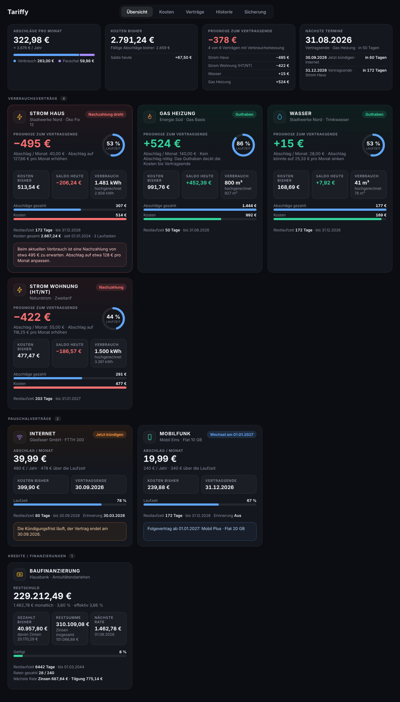
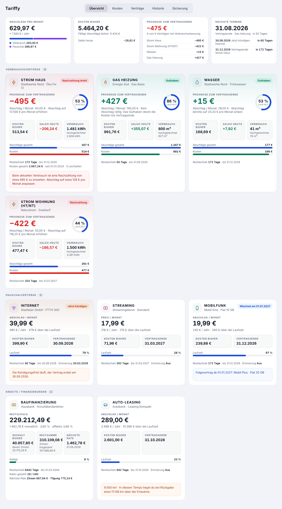

# Tariffy – Contract Management for Home Assistant / Vertragsverwaltung für Home Assistant

**[🇩🇪 Deutsche Version weiter unten](#-deutsch)**

---

<table align="center">
<tr>
<td align="center" width="50%"> Dark / Dunkel</td>
<td align="center" width="50%"> Light / Hell</td>
</tr>
</table>

*Mock data. / Beispieldaten.*

---

## 🇬🇧 English

Tariffy manages your utility and service contracts in Home Assistant: electricity, gas, water, internet, mobile, streaming, insurance, leasing, loans and more. Each contract becomes its own device with sensors for cost, balance and forecast.

### Features

- **Contracts of all kinds** – electricity (also dual-tariff), gas, water, internet, mobile, streaming, insurance, leasing (with a kilometre forecast), loans and other
- **Real consumption** – connect your meter sensor; Tariffy works out the billing forecast (credit or balance due) and a recommended instalment from the measured consumption, with optional PV self-sufficiency
- **Instalments and costs** – instalments paid, balance so far, total cost over all terms, correctable instalment history, one-off items
- **Reminders and switching** – cancellation reminder before the contract ends, plan the next contract that takes over automatically on the switch date, or renew a contract
- **Panel in the sidebar** – all contracts, costs and history at a glance, on the phone too, in light and dark design (follows Home Assistant); administrators manage contracts there
- **Backup and restore** built in; deleted contracts stay restorable for 30 days
- **German and English**, an own icon for every contract

### Installation

1. HACS → Integrations → ⋮ → **Custom repositories**
2. URL: `https://github.com/weskona/tariffy` – Category: **Integration**
3. Install Tariffy → restart Home Assistant
4. Settings → Devices & services → **Add integration** → **Tariffy**

Manual installation: copy `custom_components/tariffy` to `/config/custom_components/` and restart. Requires Home Assistant 2026.6 or newer. After an update reload the browser page once (Ctrl+F5).

### Documentation

**Everything is explained in the [Wiki](https://github.com/weskona/tariffy/wiki/EN-Home):** [Getting started](https://github.com/weskona/tariffy/wiki/EN-Getting-Started), every contract category, the panel, all sensors, automation examples, backup, FAQ and troubleshooting. Changes: [Changelog](CHANGELOG.md) · Problems and wishes: [Issues](https://github.com/weskona/tariffy/issues) (please name the version).

---

## 🇩🇪 Deutsch

Tariffy verwaltet Deine Energie- und Dienstleistungsverträge in Home Assistant: Strom, Gas, Wasser, Internet, Mobilfunk, Streaming, Versicherung, Leasing, Kredit und mehr. Jeder Vertrag wird ein eigenes Gerät mit Sensoren für Kosten, Saldo und Prognose.

### Funktionen

- **Verträge aller Art** – Strom (auch Zweitarif), Gas, Wasser, Internet, Mobilfunk, Streaming, Versicherung, Leasing (mit Kilometer-Prognose), Kredit und Sonstiges
- **Echter Verbrauch** – Zähler-Sensor verbinden; Tariffy rechnet aus dem gemessenen Verbrauch die Prognose (Guthaben oder Nachzahlung) und einen empfohlenen Abschlag, optional mit PV-Autarkie
- **Abschläge und Kosten** – gezahlte Abschläge, Saldo, Gesamtkosten über alle Laufzeiten, korrigierbarer Abschlagsverlauf, Einmalposten
- **Erinnerung und Wechsel** – Kündigungserinnerung vor dem Vertragsende, Folgevertrag planen (wird zum Wechseldatum automatisch übernommen) oder Vertrag verlängern
- **Panel in der Seitenleiste** – alle Verträge, Kosten und Historie auf einen Blick, auch auf dem Handy, in hellem und dunklem Design (folgt Home Assistant); Administratoren verwalten dort die Verträge
- **Sicherung und Wiederherstellung** eingebaut; gelöschte Verträge bleiben 30 Tage wiederherstellbar
- **Deutsch und Englisch**, ein eigenes Symbol pro Vertrag

### Installation

1. HACS → Integrationen → ⋮ → **Benutzerdefinierte Repositories**
2. URL: `https://github.com/weskona/tariffy` – Kategorie: **Integration**
3. Tariffy installieren → Home Assistant neu starten
4. Einstellungen → Geräte & Dienste → **Integration hinzufügen** → **Tariffy**

Manuell: `custom_components/tariffy` nach `/config/custom_components/` kopieren und neu starten. Benötigt Home Assistant 2026.6 oder neuer. Nach einem Update die Browserseite einmal neu laden (Strg+F5).

### Dokumentation

**Alles ist im [Wiki](https://github.com/weskona/tariffy/wiki) erklärt:** [Erste Schritte](https://github.com/weskona/tariffy/wiki/Erste-Schritte), jede Vertragssparte, das Panel, alle Sensoren, Automationsbeispiele, Sicherung, FAQ und Fehlerbehebung. Änderungen: [Changelog](CHANGELOG.md) · Probleme und Wünsche: [Issues](https://github.com/weskona/tariffy/issues) (bitte mit Versionsangabe).

---

## Lizenz / License

MIT © [weskona](https://github.com/weskona)
