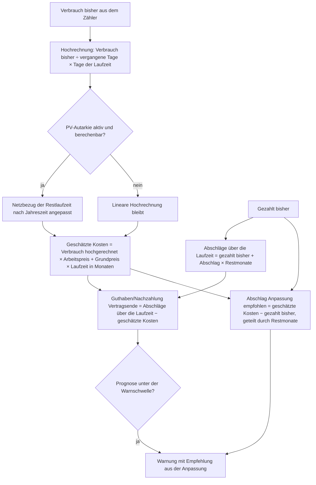

🇩🇪 Deutsch · [🇬🇧 English](EN-Payments-and-Costs)

# Abschläge und Kosten

Diese Seite erklärt, wie Tariffy aus Abschlag, Zahlweise und gemessenem Verbrauch die Kosten bisher, den Saldo, die Prognose zum Vertragsende und den empfohlenen Abschlag berechnet. Sie ist für alle, die wissen wollen, woher die Zahlen auf den Sensoren und im Panel kommen.

**Inhalt:**
- [Die Begriffe im Überblick](#die-begriffe-im-überblick)
- [Abschlag und Zahlweise](#abschlag-und-zahlweise)
- [Kosten bisher und Saldo heute](#kosten-bisher-und-saldo-heute)
- [Prognose zum Vertragsende](#prognose-zum-vertragsende)
- [Empfohlener Abschlag](#empfohlener-abschlag)
- [Warnung bei zu niedrigem Abschlag](#warnung-bei-zu-niedrigem-abschlag)
- [Kosten gesamt über alle Laufzeiten](#kosten-gesamt-über-alle-laufzeiten)
- [Beispiel](#beispiel)
- [Siehe auch](#siehe-auch)

## Die Begriffe im Überblick

Vier Sensoren haben eine Währung als Einheit. Dahinter stecken zwei Fragen: **Wann?** (Stand bis heute oder Prognose fürs Vertragsende) und **Was?** (ein reiner Betrag oder die Bilanz aus Abschlag minus Kosten).

|  | **reiner Betrag** | **Bilanz (gezahlt minus Kosten)** |
|---|---|---|
| **Bisher** | Kosten (Bisher) | Guthaben/Nachzahlung (Bisher) |
| **Vertragsende** | Abschlag (Vertragslaufzeit) | Guthaben/Nachzahlung (Vertragsende) |

- **Positiv** heißt Guthaben, **negativ** Nachzahlung. Das Attribut `tendenz` und das Symbol (Daumen hoch oder runter) zeigen es ebenfalls.
- **Abschlag (Vertragslaufzeit)** ist **keine** Kostenprognose. Es ist nur der Zahlungsplan: Abschlag mal Laufzeit in Monaten.
- **Kosten (Bisher)** gibt es als Sensor bei Strom (auch Zweizählertarif) und Gas. Die Bilanz zum Vertragsende gibt es bei allen Verträgen, sie hat aber nur mit Verbrauchssensor, Arbeitspreis und Abschlag einen Wert. Die Listen aller Sensoren stehen in der [Sensoren-Referenz](Sensoren-Referenz).

| Begriff | Bedeutung |
|---|---|
| **Abschlag** | der monatliche Betrag, den Du dem Anbieter zahlst |
| **Gezahlt bisher** | was bis heute an Abschlägen fällig war (im Panel **Abschläge gezahlt**, kein eigener Sensor) |
| **Kosten bisher** | was Dein Verbrauch bis heute tatsächlich gekostet hat |
| **Saldo heute** | Gezahlt bisher minus Kosten bisher (im Panel **Saldo heute**) |
| **Prognose zum Vertragsende** | der erwartete Saldo am Vertragsende |
| **Abschlag (Anpassung empfohlen)** | der Abschlag, der von heute bis zum Vertragsende genau ausgleicht |
| **Abschlag (Empfohlen)** | Empfehlung für die nächste Laufzeit, aus dem Verbrauch der letzten |
| **Kosten gesamt** | Kosten über alle Laufzeiten des Vertrags (im Panel, kein Sensor) |

## Abschlag und Zahlweise

**Verbrauchsverträge** (Strom, Gas, Wasser): Der **Abschlag** ist immer der Betrag **pro Monat**.

**Pauschalverträge** (Internet, Mobilfunk, Streaming, Versicherung, Leasing, Sonstiges): Das Formular fragt die **Zahlweise** (**Monatlich**, **Vierteljährlich**, **Halbjährlich**, **Jährlich**) und den **Betrag pro Zahlung (€)**. Tariffy speichert daraus den Betrag pro Monat. Bei nicht monatlicher Zahlung gibt es dazu **Erste Abbuchung am** (leer: Vertragsbeginn). Die weiteren Abbuchungen folgen im Abstand der Zahlweise.

Rechenregeln:

- **Laufzeit in Monaten** = Tage von Vertragsbeginn bis Vertragsende ÷ 30,44. Ohne Vertragsende rechnet Tariffy mit 12 Monaten.
- **Abschlag (Vertragslaufzeit)** = Abschlag × Laufzeit in Monaten.
- **Gezahlt bisher** bei Verbrauchsverträgen = Abschlag × Monate seit Vertragsbeginn (Tage ÷ 30,44, höchstens die Laufzeit).
- **Gezahlt bisher** bei Pauschalverträgen = die Summe der Abbuchungen, die bis heute fällig waren. Bei monatlicher Zahlung zählt eine Rate, sobald ihr Monat begonnen hat. Bei den anderen Zahlweisen zählt jede Abbuchung ab ihrem Tag. Für Pauschalverträge sind das gleichzeitig die **Kosten bisher**: Es gibt dort keinen Saldo und keine Prognose.
- **Ändert sich der Abschlag mitten im Vertrag**, rechnet Tariffy den alten Betrag nur bis zur Änderung und den neuen danach. Ändert sich der Abschlag über das Vertragsformular, merkt es sich das Datum und den alten Wert; mehrere Änderungen am selben Tag zählen als eine. Genauer lässt sich das mit einem Abschlagsverlauf festhalten, siehe [Abschlagsverlauf-und-Einmalposten](Abschlagsverlauf-und-Einmalposten).

## Kosten bisher und Saldo heute

```
Kosten bisher = Verbrauch bisher × Arbeitspreis + Grundpreis × vergangene Monate
Saldo heute   = Gezahlt bisher − Kosten bisher + Einmalposten der laufenden Laufzeit
```

- **Verbrauch bisher** kommt aus dem Zähler, siehe [Verbrauch-Messen](Verbrauch-Messen). Bei **Gas** wird er mit **Brennwert × Zustandszahl** in kWh umgerechnet, sofern beide eingetragen sind.
- **Vergangene Monate** = Tage seit Vertragsbeginn ÷ 30,44.
- Der **Arbeitspreis** ist der feste Preis. Bei einem **dynamischen Tarif** (Preissensor) ist es der Statistik-Mittelwert des Preissensors seit Vertragsbeginn plus Aufschlag, solange es noch keine Statistik gibt der feste Preis. Beim **Zweizählertarif** ist es der nach Verbrauch gewichtete Durchschnitt beider Preise. Beim **Wasser** gilt der Gesamtpreis aus Frischwasser und Abwasser, mit Außenzählern der gewichtete Preis.
- **Einmalposten** (Bonus, Rechnung) verändern nur den Saldo, nicht die Kosten bisher. Siehe [Abschlagsverlauf-und-Einmalposten](Abschlagsverlauf-und-Einmalposten).
- Ohne Arbeitspreis oder ohne Verbrauch gibt es weder Kosten noch Saldo.

> **Gut zu wissen:** Staffelpreise und der Nachttarif fließen in diese Rechnung nicht ein. Kosten bisher, Saldo und Prognose rechnen mit dem einen Arbeitspreis des Vertrags.

## Prognose zum Vertragsende

Die Prognose nimmt an, dass der Verbrauch im gleichen Tempo weitergeht wie bisher. Sie braucht Verbrauchssensor, Arbeitspreis und Abschlag.



*Abbildung: Rechenweg von der Hochrechnung bis zum empfohlenen Abschlag, wie ihn Tariffy im Koordinator ausführt. Die Warnung ist nur aktiv, wenn Du sie eingeschaltet hast.*

In Formeln:

```
Hochrechnung            = Verbrauch bisher ÷ vergangene Tage × Tage der Vertragslaufzeit
Geschätzte Kosten       = Hochrechnung × Arbeitspreis + Grundpreis × Laufzeit in Monaten
Abschläge über Laufzeit = Gezahlt bisher + Abschlag × (Laufzeit in Monaten − Monate bisher)
Guthaben/Nachzahlung (Vertragsende) = Abschläge über Laufzeit − Geschätzte Kosten
```

- Die Tage der Vertragslaufzeit sind Vertragsende minus Vertragsbeginn, ohne Vertragsende 365.
- Ist die [PV-Autarkie](PV-Autarkie) eingeschaltet und berechenbar, ersetzt der angepasste Netzbezug die lineare Hochrechnung. Das Attribut `prognose_ohne_autarkie` am Sensor zeigt die Prognose ohne diese Anpassung.
- **Einmalposten** gehen **nicht** in die Prognose ein. Sie ist reine Verbrauchsrechnung.
- Die Hochrechnung gibt es erst ab dem zweiten Vertragstag und mit einem Verbrauch über null.

## Empfohlener Abschlag

Es gibt zwei Empfehlungen, die sich leicht verwechseln lassen.

**Abschlag (Anpassung empfohlen)** läuft während des aktuellen Vertrags mit:

```
Abschlag (Anpassung empfohlen) = (Geschätzte Kosten − Gezahlt bisher) ÷ Restmonate
```

Das ist der monatliche Abschlag, der von heute bis zum Vertragsende genau ausgleicht. Die Rechnung gibt es, solange noch Restmonate übrig sind. Die Attribute `aktueller_abschlag` und `differenz` am Sensor zeigen den Abstand zu Deinem Abschlag. Das Panel zeigt dazu den Hinweis **Abschlag auf … pro Monat erhöhen**, **Abschlag könnte auf … pro Monat sinken**, **Der Abschlag passt** (Abstand unter 0,50 €) oder **Kein Abschlag nötig: Das Guthaben deckt die Kosten bis Vertragsende**. In der Tabelle im Tab **Kosten** steht dann in der Spalte **Empfohlen** kein negativer Betrag, sondern **0,00 €** mit dem Zusatz **Guthaben deckt die Kosten**.

**Abschlag (Empfohlen)** gibt es erst nach einem Tarifwechsel. Er beruht auf dem Verbrauch der **letzten** Laufzeit, den Tariffy beim Wechsel einfriert:

```
Abschlag (Empfohlen) = (Verbrauch letzte Laufzeit × Arbeitspreis + Grundpreis × Monate) ÷ Monate
```

`Monate` ist die tatsächliche Dauer der abgelaufenen Laufzeit (12 bei älteren, früher eingefrorenen Werten). Bei Gas wird der Verbrauch mit Brennwert × Zustandszahl in kWh umgerechnet. Arbeitspreis und Grundpreis sind die des neuen Vertrags. Die Attribute des Sensors sind `verbrauch_letzte_laufzeit`, `verbrauch_letzte_laufzeit_monate`, `aktueller_abschlag` und `differenz`.

Hat ein Vertrag beides, zeigt die Spalte **Empfohlen** im Panel den **Abschlag (Empfohlen)**.

## Warnung bei zu niedrigem Abschlag

Pro Vertrag lässt sich eine Warnung einschalten (Strom, Gas, Wasser mit Verbrauchssensor):

1. Schalte im Vertragsformular **Warnen, wenn Abschlag zu niedrig ist** ein (standardmäßig aus).
2. Stelle die **Warnschwelle (€ Nachzahlung)** ein. Vorgabe: 50 €.
3. Fällt die Prognose zum Vertragsende unter das Minus der Schwelle, erscheint eine Dauerbenachrichtigung in Home Assistant und, falls ein Benachrichtigungsdienst eingerichtet ist, einmal eine Push-Nachricht. Sie nennt die erwartete Nachzahlung und die Empfehlung aus **Abschlag (Anpassung empfohlen)**, falls berechenbar.
4. Der Button **Abschlag-Warnung bestätigen** (im Panel **Warnung bestätigen**) blendet die Meldung aus. Erholt sich die Prognose und fällt später erneut unter die Schwelle, meldet sich Tariffy wieder.

Der Rohzustand steht als Attribut `abschlag_warnung_aktiv` am Sensor **Guthaben/Nachzahlung (Vertragsende)**.

## Kosten gesamt über alle Laufzeiten

Im Panel zeigen die Vertragsdetails **Kosten gesamt**, mit **seit** dem Beginn der ersten Laufzeit und der Zahl der Laufzeiten. Es gibt dazu keinen Sensor, und die Zeile erscheint nur, wenn der Vertrag frühere Laufzeiten oder Einmalposten hat.

```
Kosten gesamt = Kosten der früheren Laufzeiten (Historie)
              + Kosten bisher der laufenden Laufzeit
              − Summe aller Einmalposten
```

- Für frühere Laufzeiten zählen deren **Kosten**, fehlen sie, die **gezahlten Abschläge**.
- Für die laufende Laufzeit zählen die **Kosten bisher**, bei Pauschalverträgen die bis heute fälligen Abschläge.
- Ein Bonus (positiv) senkt die Gesamtkosten, eine Rechnung (negativ) erhöht sie.
- Ein archivierter Vertrag zählt seine letzte Laufzeit nur einmal, aus der Historie.
- Fehlt bei einer Laufzeit jeder Betrag, steht **mindestens** vor dem Wert, denn dann ist die Summe unvollständig.
- Kredite laufen getrennt und zählen nicht in die Summen der Verträge.

## Beispiel

Dieses Beispiel stammt aus den Beispieldaten des Panels (Stichtag 12.07.2026, Vertrag Strom Haus). Es sind dieselben Zahlen wie auf dem Screenshot.

<p align="center"><picture><source media="(prefers-color-scheme: dark)" srcset="https://raw.githubusercontent.com/wiki/weskona/tariffy/images/desktop-costs.png"></picture></p>

*Abbildung: Tab Kosten mit den Beispieldaten vom 12.07.2026. In der ersten Zeile steht der Vertrag Strom Haus.*

Angaben: Vertrag 01.01. bis 31.12.2026 (364 Tage), Abschlag 40 €/Monat, Arbeitspreis 0,2977 €/kWh, Grundpreis 11,51 €/Monat. Es sind 192 Tage vergangen (6,31 Monate), die Laufzeit hat 11,96 Monate, der Zähler hat 1.481,17 kWh gezählt. Zwei Einmalposten: Wechselbonus +80 € und Honorar Makler −25 €.

```
Kosten bisher        = 1.481,17 kWh × 0,2977 € + 11,51 € × 6,31 Monate           =  513,54 €
Gezahlt bisher       = 40 € × 6,31 Monate                                        =  252,30 €
Saldo ohne Posten    = 252,30 € − 513,54 €                                       = −261,24 €
Einmalposten         = +80 € − 25 €                                              =  +55,00 €
Saldo heute          = −261,24 € + 55,00 €                                       = −206,24 €

Hochrechnung         = 1.481,17 kWh ÷ 192 Tage × 364 Tage                        = 2.808,1 kWh
Geschätzte Kosten    = 2.808,1 kWh × 0,2977 € + 11,51 € × 11,96 Monate           =  973,61 €
Abschläge über Laufzeit = 252,30 € + 40 € × (11,96 − 6,31) Monate                =  478,32 €
Prognose zum Vertragsende = 478,32 € − 973,61 €                                  = −495,29 €

Anpassung empfohlen  = (973,61 € − 252,30 €) ÷ (11,96 − 6,31) Monate             =  127,66 € pro Monat
```

Der Abschlag müsste also auf etwa **127,66 €** steigen, damit am Vertragsende nichts mehr offen ist. Das Panel zeigt dazu **Abschlag auf 127,66 € pro Monat erhöhen**. Die Prognose enthält die Einmalposten nicht; sie bleibt bei −495,29 €. **Kosten gesamt** sind 1.042,50 € + 1.166,20 € (die beiden früheren Laufzeiten) + 513,54 € − 55,00 € = **2.667,24 €**, seit 01.01.2024 über drei Laufzeiten.

Zum Vergleich der Empfehlung nach einem Tarifwechsel: Waren in der letzten Laufzeit 3.000 kWh über 12 Monate verbraucht, ergibt sich bei Arbeitspreis 0,2977 € und Grundpreis 11,51 € als **Abschlag (Empfohlen)** `(3.000 × 0,2977 + 11,51 × 12) ÷ 12 = 85,94 €`.

## Siehe auch

- [Verbrauch-Messen](Verbrauch-Messen): woher der Verbrauch kommt
- [PV-Autarkie](PV-Autarkie): Prognose mit Photovoltaik
- [Abschlagsverlauf-und-Einmalposten](Abschlagsverlauf-und-Einmalposten): Abschläge nach Zahlungen und Bonus oder Rechnung
- [Sensoren-Referenz](Sensoren-Referenz): alle Sensoren
- [Panel-Kosten](Panel-Kosten): der Tab Kosten im Panel
- [Vertragsende-und-Wechsel](Vertragsende-und-Wechsel): Tarifwechsel und Erinnerungen
