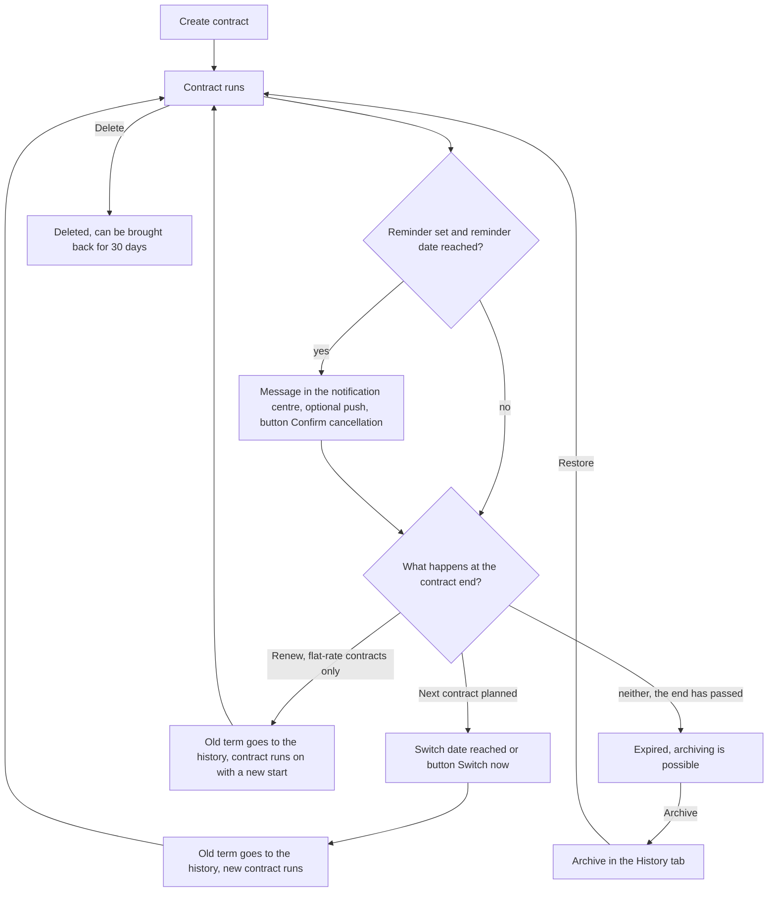

[🇩🇪 Deutsch](Vertragsende-und-Wechsel) · 🇬🇧 English

# Contract end and switching

This page shows what Tariffy does for you around the end of a contract: remind you to cancel, keep the next contract ready and switch automatically on the due date, or renew a flat-rate contract. It is for everyone who does not want to lose track of their contracts.

**Contents:**

- [The life of a contract](#the-life-of-a-contract)
- [Cancellation reminder](#cancellation-reminder)
- [Notice period and minimum term](#notice-period-and-minimum-term)
- [Planning the next contract](#planning-the-next-contract)
- [Short form for streaming](#short-form-for-streaming)
- [Automatic switch on the switch date](#automatic-switch-on-the-switch-date)
- [Renewing a contract](#renewing-a-contract)
- [The buttons per contract](#the-buttons-per-contract)
- [Example with numbers](#example-with-numbers)

## The life of a contract

The diagram shows the paths a contract can take in Tariffy. It describes only what the integration really does: nothing is archived automatically, and Tariffy never cancels for you, it only reminds you.

## Cancellation reminder

The reminder exists when the contract has a **contract end** and **Cancellation reminder** is not set to "No reminder". The choices are "1 month before" to "4 months before". You set it when you create the contract or later under **Edit contract** (see [Creating-Contracts](EN-Creating-Contracts)).

As soon as the reminder date is reached, this happens:

1. A **persistent notification** titled "Kündigung: <contract name>" appears in the Home Assistant notification centre. It names provider, tariff and contract end. The text of the message is in German.
2. If a **Notification target (notify service)** is set, **one** push message with the same text is sent. The target is optional, for example `notify.mobile_app`.
3. The button **Confirm cancellation** becomes available. With it you acknowledge the reminder: the persistent notification disappears and does not come back for this term.

The reminder is on from the reminder date up to and including the contract end. After that it is off. The sensor "Cancellation reminder" shows the reminder date as its value, and the panel shows it as "Reminder from" in the contract details.

You can acknowledge in three places, they do the same:

- with the button **Confirm cancellation** on the contract's device in Home Assistant,
- in the panel, in the **Contracts** tab, in the details of the contract (the button there is called **Acknowledge cancellation**, a confirmation question follows, see [Panel-Contracts](EN-Panel-Contracts)),
- in the **Next contract** dialog with the tick box **Mark the cancellation as done** (see below).

> **Good to know:** Entering a next contract does not end the reminder by itself. You acknowledge it yourself, or you leave the tick box in the next-contract dialog switched on.

> **Good to know:** If the contract end, the reminder lead time or the notice period change while editing, the reminder starts over: the acknowledgement and the "push already sent" marker are forgotten. If none of them changes, both are kept. An archived contract no longer reminds, and archiving removes the persistent notification.

## Notice period and minimum term

Both fields are optional and are in the contract form (creating and **Edit contract**).

- **Notice period (months):** how many months before the contract end the cancellation must be received. If it is set, the reminder refers to the **last day to cancel** (contract end minus notice period) instead of the contract end. The message names that day. The sensor "Cancellation reminder" has the attributes `kuendigungsfrist_monate` and `kuendigung_bis` for it.
- **Minimum term (months):** the panel shows "until <start + minimum term>". It does not affect any reminder.

Rule for the reminder date: contract end minus (reminder months plus notice period). If the reminder is set to "No reminder", there is no reminder even with a notice period; the last day to cancel is still shown.

> **Good to know:** A tariff switch keeps the notice period, not the minimum term.

## Planning the next contract

If you already know what comes next, enter the next contract. Tariffy then takes it over by itself on the switch date.

**In the panel (administrators):**

1. Open the **Contracts** tab.
2. In the contract's row click the icon **Plan next contract** (if a next contract is already stored, it says **Edit next contract**).
3. Fill in the dialog "Next contract · <contract name>". Fields you leave empty keep the value of the running contract.
4. Click **Save**. Home Assistant then reloads the contract.

Alternatively you can do it in Home Assistant under **Settings → Devices & services → Tariffy → [Contract] → Options**; it is the same form the panel opens. For a loan the panel shows no icon for a next contract, it has a follow-up financing instead (see [Contract-Loan](EN-Contract-Loan)).

*Figure: The dialog "Next contract · Internet" with mock data (German interface). The date format follows your browser.*

The fields of the form (for electricity, gas and water, unit price, consumption values and more are added depending on the contract):

| Field | Meaning |
|-------|---------|
| Switch date (start of new contract) | The day the new contract takes over. **Leaving it empty removes a planned switch.** |
| Provider (new), Customer number (new), Tariff name (new) | New master data |
| Instalment new (€/month), Base price new (€/month) | New amounts |
| Contract end new / valid until | End of the new term |
| Mark the cancellation as done | Only in the panel and only while the reminder is active. Ticked by default: after saving, the reminder is acknowledged. |

With **Remove planned contract** (asks first) you take the plan back; the running contract stays unchanged. A planned contract shows as a note "Next contract from <date>: <name>" and on the sensor "Next switch" (value: the switch date, attributes: the new values).

## Short form for streaming

The **Streaming** kind has a shorter form, also called "Plan next contract":

| Field | Meaning |
|-------|---------|
| Start of the new term | Without input the **day after the contract end** is suggested. Leaving it empty removes a planned contract. |
| Tariff name (new) | Name of the new tariff |
| Payment interval (new) | Monthly, Quarterly, Half-yearly or Yearly, for example from yearly to monthly |
| Amount per payment (new, €) | The amount per debit; Tariffy converts it to the monthly amount internally |
| End of the new term / valid until | End of the new term |

Provider, customer number and base price are shown only if an already planned contract has them. Whatever you do not change stays as in the running contract, including the payment interval. The first debit of the new term is its start. All other kinds keep their normal form. More on streaming: [Contract-Streaming](EN-Contract-Streaming).

## Automatic switch on the switch date

Tariffy checks the switch every day at 00:00:01, also on every regular update (every 6 hours) and after Home Assistant starts. If the switch date is reached or passed, this happens:

1. For electricity, gas and water the **consumption of the ending term is frozen** (sensor "Consumption (last period)") together with its real duration in months. The sensor "Monthly payment (recommended)" works from it for the new contract. Details and a worked example are on [Next-Contract-or-Renew](EN-Next-Contract-or-Renew).
2. The **old term goes to the history** (period, provider, tariff, prices, instalment, cost, consumption, balance; no customer or meter numbers), see [Archive-and-History](EN-Archive-and-History). At most 50 terms are kept per contract, the oldest drop out.
3. The **contract data is replaced by the next contract**. Fields you left empty in the next contract keep their previous value.
4. The integration reloads the contract, because the new contract may need other sensors (for example for tiered prices).

Also kept are the reminder lead time, notice period, notification target, one-off items, own icon, the PV self-sufficiency settings, the outdoor meters of a water contract (without their start value) and, for leasing, the vehicle and the kilometre rules. Not kept are the payment history, the minimum term, a manual meter reading at contract start, the odometer at start and a manually entered odometer. Acknowledgements and "push sent" markers of the old term are dropped too, so the reminder starts over for the new contract end.

> **Good to know:** The option "Warn if instalment is too low" with its warning threshold is not among the values that are kept. Check it under **Edit contract** after a switch.

> **Good to know:** The switch also happens if Home Assistant was off on the switch day: it is made up on the next start. The consumption of the old term is then determined from the long-term statistics of the meter. If they are missing, or a manual meter reading at contract start is set, nothing is frozen.

## Renewing a contract

**Renew** exists for contracts without a consumption meter (internet, mobile, streaming, insurance, leasing, loan, other) as long as they are not archived. Electricity, gas and water cannot be renewed, use the next contract for them. A **contract end is not required**: an open-ended contract can be renewed too, for example after a price adjustment.

1. In the panel open the **Contracts** tab and click the icon **Renew contract** (two arrows in a circle) in the row.
2. The dialog suggests a start on the day after the current end and a new end one year later. If the contract has no end, the start is today and the end is empty. Payment interval and amount are pre-filled as before.
3. Enter the new **Amount per payment**. The dialog shows at once by how many percent the contract gets dearer or cheaper, compared per month.
4. Click **Renew**.

*Figure: The dialog "Renew contract" with mock data (German interface): 432 € a year instead of 39.99 € a month makes 36.00 € a month, so "10,0 % günstiger" (10.0 % cheaper).*

This happens when you renew:

- The current term goes to the **history**.
- The contract runs on with the new start, end and amount. Provider, tariff, customer number and everything else stay.
- Acknowledged reminders, the payment history and an archive marker belong to the old term and start over. The reminder follows the new end.
- An open reminder and the instalment warning are removed as notifications.
- The **First debit (optional)** is only needed if the first debit of the new term is not on its start.

A **loan** has a **follow-up financing** instead, with a new amount, interest and term; the amount is usually the remaining debt (see [Contract-Loan](EN-Contract-Loan)).

## The buttons per contract

In Home Assistant every contract has three buttons on its device. They are available only when they can do something.

| Button | Available when | Effect |
|--------|----------------|--------|
| Switch now | a next contract is planned | Takes over the next contract at once, without waiting for the date. Freezes the consumption of the ending term exactly like the automatic switch. |
| Confirm cancellation | the reminder is active right now | Acknowledges the reminder and removes the persistent notification. |
| Confirm low-instalment warning | the back-payment warning is waiting to be acknowledged | Acknowledges the warning and removes the persistent notification. If the forecast later recovers above the threshold and then worsens again, the warning comes back by itself. |

> **Good to know:** **Switch now** exists only as a button in Home Assistant, not in the panel. The start of the new term is the stored switch date, even if it is still in the future.

## Example with numbers

Example: an electricity contract ends on 31 Dec, the notice period is 3 months, and **Cancellation reminder** is set to "3 months before".

- The cancellation has to be received by **30 Sep** (31 Dec minus 3 months).
- The reminder comes on **30 Jun** (31 Dec minus 3 plus 3 months), 6 months before the contract end.
- The message names 30 Sep as the last day to cancel. You cancel with the provider and press **Confirm cancellation**.
- Without a notice period the reminder would come on 30 Sep, three months before the end.

This matches the integration's tests (contract end 31 Dec 2026, notice period 3, reminder 3: last day to cancel 30 Sep 2026, reminder date 30 Jun 2026).

## See also

- [Next-Contract-or-Renew](EN-Next-Contract-or-Renew): what changes in the sensors, and when to use which
- [Archive-and-History](EN-Archive-and-History): archive expired contracts, view and add earlier terms
- [Automations](EN-Automations): your own reminders and warnings
- [Creating-Contracts](EN-Creating-Contracts): set the reminder, notice period and notification target
- [Panel-Contracts](EN-Panel-Contracts): all actions in the Contracts tab
- [Payments-and-Costs](EN-Payments-and-Costs): instalment warning and recommended instalment
