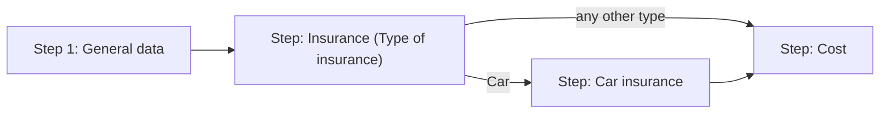

[🇩🇪 Deutsch](Vertrag-Versicherung) · 🇬🇧 English

# Contract: Insurance

The category **Insurance** is a **flat-rate contract** for premiums that are often debited only once a year. On top of that there are optional details about the type of insurance and, for a car insurance, about the car. These details are for documentation only, nothing is calculated from them.

**Contents:**
- [The flow in the form](#the-flow-in-the-form)
- [Step by step](#step-by-step)
- [Fields at a glance](#fields-at-a-glance)
- [What Tariffy shows](#what-tariffy-shows)
- [Premium rises: renew](#premium-rises-renew)
- [Worked example](#worked-example)
- [Typical mistakes](#typical-mistakes)
- [See also](#see-also)

## The flow in the form

An insurance has a step of its own before the cost:



Only the type **Car** is followed by the step with the details of the car. All other types go straight on to the cost. The cost step is the same as for [Internet and Mobile](EN-Contract-Internet-and-Mobile).

## Step by step

1. In the panel, click **New contract** in the **Contracts** tab. The general steps are on [Creating Contracts](EN-Creating-Contracts).
2. **Step 1:** enter label, category **Insurance**, provider, contract start, contract end, notice period and reminder.
3. **Insurance:** choose the **Type of insurance** (or leave it empty).
4. **Only for Car:** enter **Licence plate**, **Odometer at contract start (km)** and **Allowed kilometres per year (km)**, all optional.
5. **Cost:** choose the **payment interval** (for insurances often **Yearly**) and enter the **amount per payment (€)**, for example the yearly premium. For a payment that is not monthly, set **Date of the first debit**.

Later you change everything with **Edit contract**; the steps are the same.

## Fields at a glance

Step 1 and the cost step are described on [Contract: Internet and Mobile](EN-Contract-Internet-and-Mobile#fields-at-a-glance). An insurance has in addition:

**Step "Insurance":**

| Field | Required | Meaning | Default |
|-------|----------|---------|---------|
| Type of insurance | no | What the insurance covers: Car, Building / house, Household contents, Liability, Health, Life, Legal protection, Accident, Other | empty |

**Step "Car insurance"** (only for Car):

| Field | Required | Meaning | Default |
|-------|----------|---------|---------|
| Licence plate | no | The licence plate; counts as personal (see below) | empty |
| Odometer at contract start (km) | no | Odometer reading at the start of the contract | empty |
| Allowed kilometres per year (km) | no | Kilometres per year agreed in the contract | empty |

## What Tariffy shows

- **In the panel** the contract details show the **Type of insurance**, the **Odometer at start** and **Allowed per year**. The side panel does **not** show the **licence plate**: like the customer number it counts as personal. In the diagnostics download it is blacked out.
- **As sensors** Tariffy creates four sensors for an insurance: **Type of insurance**, **Licence plate**, **Odometer at contract start** and **Allowed kilometres per year**. Other categories (except Leasing, which gets the three vehicle sensors) do not have these sensors. Note: the sensor "Licence plate" shows the value in Home Assistant.
- **The costs** work like for any flat-rate contract: **cost so far** is the instalments booked. If you do not pay monthly, every **debit** counts on the day of the payment, not a monthly share. The contract details show the first and the **next payment**.

> **Good to know:** if you change the type from "Car" to something else when editing, licence plate, odometer and kilometres per year are dropped and the car step is skipped.

## Premium rises: renew

Insurance premiums often rise at the turn of the year. For this the **Contracts** tab has the icon **Renew contract** (administrators only). The dialog suggests a start on the day after the current end, a new end one year later, and interval and amount as before. You enter the new premium and see at once by how many percent the contract gets dearer or cheaper (compared per month). With **Renew** the current term goes to the **history**; that gives one entry per year and you see how the premium rises. More on [Next Contract or Renew](EN-Next-Contract-or-Renew).

## Worked example

Example values (not from a real contract): car insurance "Kfz Allianz" at "Versicherer AG", type **Car**, start 1 January 2026, end 31 December 2026, licence plate "B-XY 1234", odometer at contract start 12,000 km, allowed 10,000 km per year.

The insurer debits the yearly premium of **896.63 €**. In the cost step you choose the payment interval **Yearly** and enter 896.63.

```
The monthly amount is stored:   896.63 € / 12 = 74.72 € a month  (rounded)
Cost so far in 2026:            896.63 €   (the one debit)
```

So shortly after the start Tariffy shows 896.63 € as the cost so far, not 74.72 €. If you renew the contract for 1 January 2027 and enter 940 €, the dialog says "4.8 % dearer" (940 / 12 = 78.33 € instead of 74.72 € per month). The **total cost** then counts the earlier term from the history plus the debits of the new term.

## Typical mistakes

- **Yearly premium with payment interval "Monthly".** Then Tariffy counts the yearly premium twelve times. Choose **Yearly** (or work out the monthly amount).
- **First debit not set.** If the insurer does not debit on the contract start, set **Date of the first debit**, otherwise Tariffy assumes the contract start.
- **Looking for the licence plate in the panel.** The panel deliberately does not show it; it is in the sensor "Licence plate".
- **Car details missing.** The car step only appears for the type **Car**; if the type is empty, it is skipped.
- **Expecting the kilometres to be calculated.** For an insurance the kilometres are only documented. A calculation against the odometer exists only for [Leasing](EN-Contract-Leasing).

> **Good to know:** when you edit, all fields are filled in with the current values. An empty optional field removes the value.

## See also

- [Contract: Internet and Mobile](EN-Contract-Internet-and-Mobile)
- [Contract: Leasing](EN-Contract-Leasing)
- [Next Contract or Renew](EN-Next-Contract-or-Renew)
- [Payments and Costs](EN-Payments-and-Costs)
- [Sensor Reference](EN-Sensor-Reference)
