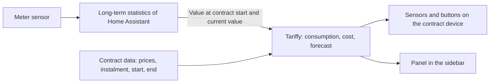

[🇩🇪 Deutsch](Erste-Schritte) · 🇬🇧 English

# Getting started

This page takes you from installation to your first contract: install Tariffy through HACS, add the integration, create a contract and find it again in the panel. It takes about five minutes.

**Contents:**

- [Requirements](#requirements)
- [Installation through HACS](#installation-through-hacs)
- [Enabling beta versions](#enabling-beta-versions)
- [Manual installation](#manual-installation)
- [Adding the integration](#adding-the-integration)
- [Your first contract in five minutes](#your-first-contract-in-five-minutes)
- [From the meter to the panel](#from-the-meter-to-the-panel)
- [The panel in the sidebar](#the-panel-in-the-sidebar)
- [What a contract looks like in Home Assistant](#what-a-contract-looks-like-in-home-assistant)

## Requirements

- Home Assistant 2026.6 or newer.
- HACS (for easy installation and later updates).
- For real consumption tracking, a meter sensor with a long-term statistic, for example a sensor from the Energy dashboard. Tariffy also works without a meter sensor, but then it does not calculate consumption.

## Installation through HACS

1. In Home Assistant open **HACS → Integrations → ⋮ → Custom repositories**.
2. Enter `https://github.com/weskona/tariffy` as the URL and choose the category **Integration**.
3. Install **Tariffy** and restart Home Assistant.
4. Go to **Settings → Devices & services** and add **Tariffy** (see [Adding the integration](#adding-the-integration)).

HACS normally offers you stable versions only. It reports updates like for any other integration.

## Enabling beta versions

Unfinished work is published as a beta pre-release, so normal users never get it by accident. If you want to test:

1. Open **HACS → Tariffy → ⋮ → Redownload** and switch on **Show beta versions**.
2. Pick a version like `1.27.0-beta.1` and restart Home Assistant.
3. If you report a problem, name the exact beta version.

Without this setting HACS offers stable versions only; a beta never replaces the stable version for anyone who did not opt in. More on this at [Releases and beta](EN-Releases-and-Beta).

## Manual installation

Copy the folder `custom_components/tariffy` to `/config/custom_components/` and restart Home Assistant:

```bash
cp -r custom_components/tariffy /config/custom_components/
```

## Adding the integration

In Tariffy every contract is its own entry of the integration. So you add the integration once per contract:

1. Open **Settings → Devices & services**.
2. Click **Add integration** and search for **Tariffy**.
3. The form **Add contract** ("General contract data.") opens. Required fields are **Label (e.g. Electricity House)**, **Category**, **Provider** and **Cancellation reminder**.
4. Depending on the **Category** a second form follows with the prices and meter data (for some categories a third step). Saving the last step creates the contract.

You create further contracts the same way, or in the panel with the button **New contract** (administrators only, see below).

## Your first contract in five minutes

As an example we create an electricity contract. The numbers come from the example contract "Strom Haus" that the screenshots in this wiki use as well (mock data, date 12 July 2026).

**Step 1: General contract data**

| Field | Entry in the example |
|---|---|
| Label (e.g. Electricity House) | Strom Haus |
| Category | Electricity |
| Provider | Stadtwerke Nord |
| Tariff name | Öko Fix 12 |
| Contract start | 01.01.2026 |
| Contract end / valid until | 31.12.2026 |
| Cancellation reminder | 3 months before (default) |

All other fields are optional. An overview of all general fields is at [Creating contracts](EN-Creating-Contracts).

**Step 2: Electricity details**

| Field | Entry in the example |
|---|---|
| Unit price (€/kWh) | 0.2977 |
| Base price (€/month) | 11.51 |
| Monthly instalment (€/month) | 40 |
| Consumption sensor (optional) | your meter sensor, in the example `sensor.strom_haus` |

You find the prices on your bill. You need the **Consumption sensor** so that Tariffy measures the real consumption since contract start; without it cost, balance and forecast stay empty. [Contract electricity](EN-Contract-Electricity) explains every field.

**Step 3: Save**

Save the form. Tariffy creates the device with its sensors and reads the meter value at contract start from the long-term statistics. After the first update the values appear in the panel and on the sensors. The values are refreshed every 6 hours, at 00:00:01 and after Home Assistant starts.

In the example this gives (1,481.17 kWh since the start, as of 12 July 2026): cost so far 513.54 €, balance today −261.24 € (balance due), forecast at contract end −495.29 €. The calculation step by step is at [Contract electricity](EN-Contract-Electricity#worked-example).

> **Good to know:** If you do not need consumption tracking (for example for internet or insurance), choose another category. There you only enter an amount and the payment interval. The categories are listed at [Creating contracts](EN-Creating-Contracts#all-categories-at-a-glance).

## From the meter to the panel

Tariffy does not measure by itself, it works with what Home Assistant knows about your meter. From the long-term statistics Tariffy reads the meter value at contract start and the current value; the difference is the consumption since contract start. Together with the prices from the contract this gives cost, balance and forecast.



*Figure: The way from the meter sensor through Tariffy to the sensors and the panel.*

Important:

- Tariffy mainly reads the cumulative sum (`sum`) of the long-term statistics, not only the raw sensor value. This makes the calculation robust against meters that reset to zero now and then.
- If the statistics do not reach back to the contract start, enter a **Meter reading at contract start (optional)** in the form; it takes priority.
- If your meter reports in Wh or MWh, Tariffy converts to kWh.

More on this at [Measuring consumption](EN-Measuring-Consumption).

## The panel in the sidebar

As soon as at least one contract is loaded, the entry **Tariffy** (icon `mdi:cash-multiple`) appears in the Home Assistant sidebar. The panel is part of the integration; there is nothing to install. After an update, hard-reload the browser page once (Ctrl+F5) so that the new panel file is loaded.

The panel has five views: **Overview**, **Costs**, **Contracts**, **History** and **Backup** (only administrators see the backup). You create the contract in the **Contracts** tab; all actions that change a contract are there as well.

<table align="center"><tr><td align="center" width="50%"><br><sub>Dark</sub></td><td align="center" width="50%"><br><sub>Light</sub></td></tr></table>

*Figure: The "Contracts" tab with the button "New contract" (mock data, date 12 July 2026).*

On a phone the cards turn into expandable rows:

<table align="center"><tr><td align="center"><br><sub>Dark</sub></td><td align="center"><br><sub>Light</sub></td></tr></table>

*Figure: The overview on a phone (German panel).*

Everything else about the panel is at [Panel overview](EN-Panel-Overview) and [Panel contracts](EN-Panel-Contracts).

> **Good to know:** All users see the panel, but only administrators may create, edit and delete contracts. What each user sees is explained at [Panel permissions and design](EN-Panel-Permissions-and-Design).

## What a contract looks like in Home Assistant

Every contract becomes its own **device** in Home Assistant:

- **Name:** the label you entered (for example "Strom Haus").
- **Manufacturer:** the provider.
- **Model:** the category (for example "Electricity", for the dual tariff "Electricity (HT/NT)").
- **Sensors:** prices, instalment, consumption, cost, balance, forecast, remaining term and more. Provider, customer number, tariff and meter number are diagnostic sensors. [Sensor reference](EN-Sensor-Reference) lists which sensors exist for which category.
- **Buttons:** **Switch now** (only available when a next contract is planned), **Confirm cancellation** (only while the cancellation reminder is active) and **Confirm low-instalment warning** (only with an open warning).

Entity IDs are built from the device name and the sensor name (for example `sensor.strom_haus_unit_price`); your IDs may differ.

## See also

- [Creating contracts](EN-Creating-Contracts): all categories, general fields, editing and deleting
- [Contract electricity](EN-Contract-Electricity), [Contract gas](EN-Contract-Gas), [Contract water](EN-Contract-Water)
- [Measuring consumption](EN-Measuring-Consumption)
- [Panel overview](EN-Panel-Overview)
- [Releases and beta](EN-Releases-and-Beta)
- [Troubleshooting](EN-Troubleshooting)
