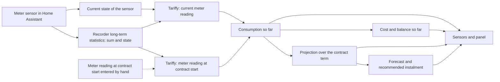

[🇩🇪 Deutsch](Verbrauch-Messen) · 🇬🇧 English

# Measuring consumption

This page explains how Tariffy uses a meter sensor from Home Assistant to work out the real consumption since the contract start and to project it over the contract term. It is for everyone who wants costs, balance and forecast for electricity, gas or water from real measurements, and for everyone whose values stay empty.

**Contents:**
- [How the data flows](#how-the-data-flows)
- [Choosing the consumption sensor](#choosing-the-consumption-sensor)
- [Units](#units)
- [Meter reading at contract start](#meter-reading-at-contract-start)
- [Consumption so far and projection](#consumption-so-far-and-projection)
- [When statistics are missing](#when-statistics-are-missing)
- [Special cases](#special-cases)
- [Checklist for missing data](#checklist-for-missing-data)
- [Example](#example)
- [See also](#see-also)

## How the data flows

Tariffy does not count by itself. It reads the meter value from the **long-term statistics** of the Home Assistant recorder and compares it with the value at the contract start.



*Figure: Data flow from the meter sensor to the sensors and the panel. The dashed line shows the meter reading at contract start that you can enter yourself.*

The consumption sensor is optional. Without it Tariffy works with the estimated annual consumption from the contract, and there are no sensors for measured consumption, cost so far and a forecast based on real values.

## Choosing the consumption sensor

The field **Consumption sensor (optional)** exists in the contract forms for electricity, gas, water and electricity (dual tariff). For a dual-tariff meter **Consumption sensor, low tariff / NT (optional)** is added for the second register.

1. Open the contract for editing: in the panel with **Edit contract**, in Home Assistant through the reconfiguration of the entry (Settings, Devices & services, Tariffy).
2. Under **Consumption sensor (optional)** choose the sensor of your meter. It should deliver the **meter reading** that keeps counting up, not the consumption of the day.
3. Save. Home Assistant reloads the contract and Tariffy reads the statistics.
4. After a short while check whether **Consumption (so far)** has a value (see [Sensor-Reference](EN-Sensor-Reference)).

For cost, balance and forecast to appear, the contract also needs a **unit price**. The balance and the forecast also need an **instalment**.

> **Good to know:** Tariffy reads the **sum** (`sum`) of the long-term statistics. Home Assistant keeps it for meters that keep counting up (typically `state_class: total_increasing` or `total`). A sensor that only delivers momentary values such as a power in watts has no such sum. The sensor must not be excluded from the recorder.

## Units

Tariffy only converts what is clearly unambiguous. Everything else is taken as your sensor reports it.

| Unit of the meter | What Tariffy does |
|---|---|
| kWh | stays as it is |
| Wh | is converted to kWh (factor 0.001) |
| MWh | is converted to kWh (factor 1000) |
| no unit | stays as it is |
| m³, litres, others | stays as it is: the consumption is in the unit of the sensor |

- The unit is read from the current state of the sensor. If the state is missing (for example right after a start), the unit of the long-term statistics applies. Upper or lower case does not matter.
- The sensors **Consumption (so far)**, **Consumption (contract term projected)** and **Consumption (last period)** always show kWh for electricity. For gas and water they show the unit of your meter (a Wh or MWh meter is shown as kWh). If the meter reports no unit, the unit from the contract data applies.
- **Gas:** The consumption stays in the unit of the meter (usually m³). For **Cost (so far)** and the forecast Tariffy converts to kWh with **calorific value × state number**, provided both are entered in the contract. The conversion of therm or MBtu only applies to the estimated annual consumption from the contract data, not to the meter.
- **Water:** The main meter is **not** converted between litres and m³. The unit of the meter should match the unit of the price. Only for an **outdoor meter** (garden, pool) does Tariffy convert between litres and m³ so that it matches the main meter.

## Meter reading at contract start

The consumption is the difference between the meter reading today and the meter reading at the contract start. Tariffy gets the reading at the contract start like this:

1. **Entered by hand:** If you entered a value in the field **Meter reading at contract start (optional)**, it takes priority. Tariffy subtracts it from the current reading, in the unit of your meter (for a Wh meter you enter the value in Wh).
2. **From the long-term statistics:** Otherwise Tariffy looks for hourly statistics values from the day before the contract start up to three days after. It takes the first value on or after the contract start.
3. **Fallback before:** If that window only holds values from before the contract start, Tariffy takes the last of them.
4. **Fallback after:** If the window holds nothing at all, Tariffy takes the earliest value of the following two years (730 days). That happens when the sensor was created after the contract start. Then the consumption before that is missing, and the measured consumption is too low. In this case enter the meter reading at the contract start by hand.

Tariffy remembers the value it found as long as Home Assistant runs. After a restart or reload it reads it again.

## Consumption so far and projection

**Consumption so far** is the current meter reading minus the reading at the contract start, in kWh for Wh and MWh meters. Which way Tariffy calculates depends on the meter:

- **Normal case, the meter has not jumped back:** Tariffy takes the difference of the raw states (current state minus state at the contract start). This protects against rare outliers in the statistics sum itself, for example after a restart.
- **The meter jumped back (reset):** Then the current state is lower than the one at the contract start. Tariffy takes the difference of the **sum** from the long-term statistics, because the sum already accounts for such resets. This applies, for example, to some gas meters and smart-meter integrations with `total_increasing`.
- **Current value:** Tariffy takes the current state of the sensor. If the sensor is `unavailable` or `unknown` at the moment and you entered a meter reading by hand, the last recorded statistics value is used.

From this Tariffy calculates:

```
Consumption (contract term projected) = consumption so far ÷ days passed × days of the contract term
```

- The **days of the contract term** are contract end minus contract start. Without a contract end Tariffy uses 365 days. A contract over six months is therefore projected over those six months and not over a calendar year.
- The projection only exists once at least one day has passed and the consumption is greater than zero.
- For electricity, [PV-Self-Sufficiency](EN-PV-Self-Sufficiency) can adjust the remaining term of the projection for the season.
- **Cost (so far)**, **Refund/balance due (so far)** and the forecast at the contract end are built on this consumption. How, is explained in [Payments-and-Costs](EN-Payments-and-Costs).

## When statistics are missing

If Tariffy finds no meter reading for the contract start, **Consumption (so far)** stays `unknown`, and all values that depend on it stay empty as well. The sensors show no error message. Tariffy tries again at every update and writes **one** warning line to the log when the consumption becomes unknown, and one info line when it is back.

This is the case when:

- the sensor keeps no long-term statistics with a sum,
- the statistics do not reach back to the contract start because the sensor was renamed or recreated (the statistics belong to the entity),
- there is no statistics value in the whole period before and two years after.

The way out is the meter reading at the contract start entered by hand. With it Tariffy needs no statistics for the contract start, only the current state of the sensor or, if that is missing at the moment, the last recorded value.

## Special cases

- **Dual-tariff meter (HT/NT):** Each register has its own sensor and its own field **Meter reading at contract start, NT (optional)**. The consumption so far is the sum of both registers. There are also separate sensors for high and low tariff. The unit price for the projection is the average of both prices weighted by consumption. More in [Contract-Electricity](EN-Contract-Electricity).
- **Outdoor meters for water:** Each outdoor meter has its own sensor with its own start value. Its consumption is part of the main meter and is calculated without wastewater. More in [Contract-Water](EN-Contract-Water).
- **Earlier terms:** At a tariff switch Tariffy freezes the consumption of the ending term, calculated the same way as above. This gives the sensor **Consumption (last period)** and the **Monthly payment (recommended)**, see [Payments-and-Costs](EN-Payments-and-Costs).

## Checklist for missing data

Go through the points in order:

1. **Does the sensor deliver numbers?** Open the meter sensor in Home Assistant. The state must be a number, not `unavailable` or `unknown`.
2. **Is there a statistic?** The sensor must be listed under Statistics in the developer tools, without a hint about a problem. A meter needs `state_class` `total_increasing` or `total` and a unit for that.
3. **Do the statistics reach back to the contract start?** If the sensor came later, the reading at the contract start is missing. Then enter **Meter reading at contract start (optional)** by hand, best from your bill.
4. **Is the contract start right?** Check the date in the contract. The projection needs at least one day that has passed.
5. **Is there a unit price?** Without a unit price there is no cost, no balance and no forecast, even if the consumption is there. Balance and forecast also need an instalment.
6. **Are the units right?** A Wh meter is converted. If the meter reports litres but the price is per m³, the costs do not fit (see [Units](#units)).
7. **Restart or reload:** Tariffy updates after Home Assistant has started, every 6 hours and daily at 00:00:01. Reload the contract after you changed something.
8. **Download the diagnostics:** Under Settings, Devices & services the diagnostics of the contract can be downloaded. The section `verbrauch` shows which way Tariffy took (`statistik` or `manueller_startwert`), the values it read (`aktuell_sum`, `aktuell_state`, `offset_sum`, `offset_state`) and the result. The section `zaehler` shows state, unit and `state_class` of the sensor. Customer number, meter number and market location are redacted in the file.
9. **Log:** Search the logs for `Tariffy` and `Verbrauch bisher ist unbekannt`.

If none of this helps, more is in [Troubleshooting](EN-Troubleshooting).

## Example

This example comes from the sample data of the panel (reference date 12 July 2026, contract Strom Haus) and from the Tariffy tests.

- Contract: 1 Jan 2026 to 31 Dec 2026, unit price 0.2977 € per kWh.
- The meter shows **2,481.17 kWh** today. The statistics give **1,000.00 kWh** for 1 Jan 2026.
- **192 days** have passed since the contract start, the contract has **364 days**.

```
Consumption (so far)                  = 2,481.17 kWh − 1,000.00 kWh = 1,481.17 kWh
Consumption (contract term projected) = 1,481.17 kWh ÷ 192 days × 364 days = 2,808.1 kWh
```

If the same meter reports in Wh (2,481,170 Wh today, 1,000,000 Wh at the contract start), the result is the same: Tariffy calculates in kWh, not 1,481,170. If the statistics had not reached the contract start, you would enter `1000` under **Meter reading at contract start (optional)**.

What these numbers turn into as cost and balance is worked out further in [Payments-and-Costs](EN-Payments-and-Costs) for the same contract.

## See also

- [Payments-and-Costs](EN-Payments-and-Costs): cost, balance, forecast and recommended instalment
- [PV-Self-Sufficiency](EN-PV-Self-Sufficiency): forecast with photovoltaics and battery
- [Sensor-Reference](EN-Sensor-Reference): all sensors and attributes
- [Contract-Electricity](EN-Contract-Electricity), [Contract-Gas](EN-Contract-Gas), [Contract-Water](EN-Contract-Water): the contract forms
- [Troubleshooting](EN-Troubleshooting)
