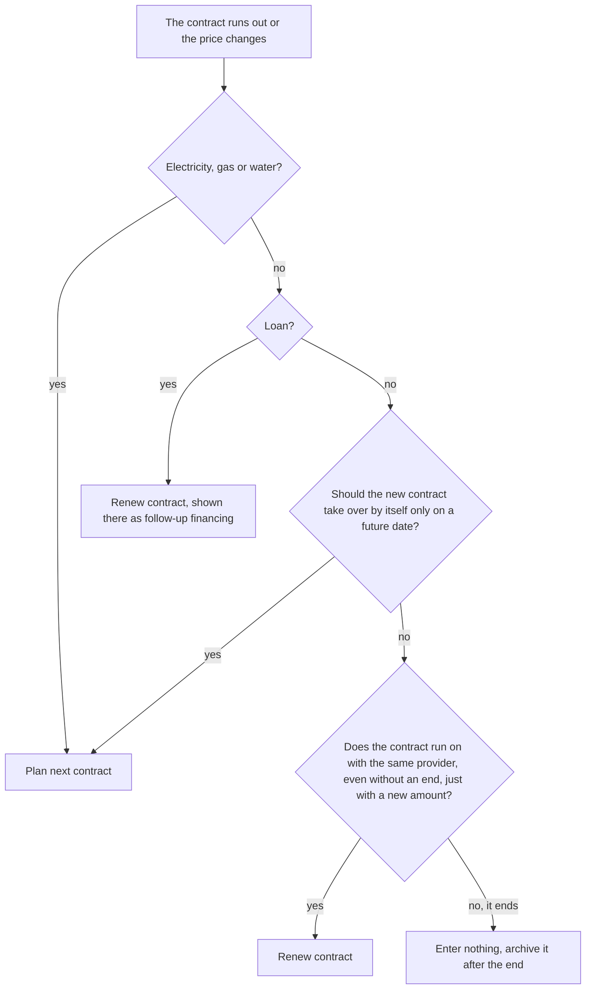

[🇩🇪 Deutsch](Folgevertrag-oder-Verlaengern) · 🇬🇧 English

# Next contract or renew

When a contract runs out, Tariffy knows two ways forward: the **next contract**, which takes over by itself on a date, and **renewing**, where the same contract runs on with a new start, end and amount. This page helps you choose and shows what changes in the sensors afterwards.

**Contents:**

- [Which way do I take?](#which-way-do-i-take)
- [The differences at a glance](#the-differences-at-a-glance)
- [What changes in the sensors](#what-changes-in-the-sensors)
- [Example with numbers](#example-with-numbers)

## Which way do I take?



In short:

- **Electricity, gas, water:** always the next contract. Renewing does not exist here.
- **Flat-rate contract with a new provider or tariff from a fixed day:** next contract. You enter it today, Tariffy switches on the switch day.
- **Flat-rate contract that simply runs on with the same provider** (new premium, price adjustment, also for a contract without an end): renew. It applies at once when you save.
- **Loan:** follow-up financing via **Renew contract**.
- **The contract ends and nothing follows:** enter nothing. After the end you can archive it (see [Archive-and-History](EN-Archive-and-History)).

## The differences at a glance

| | Next contract | Renew |
|---|---|---|
| For which contracts | all kinds, in the panel except loans | contracts without a consumption meter (internet, mobile, streaming, insurance, leasing, loan, other), not archived |
| When it applies | by itself on the switch date, or at once with the button **Switch now** | at once when you save |
| What you enter | only what changes; empty fields keep the value of the running contract | start, end (may be empty), payment interval, amount per payment, optionally First debit |
| Old term | goes to the history | goes to the history |
| Consumption of the old term | is frozen for electricity, gas and water | not applicable (flat-rate contracts have no consumption) |
| Reminder | starts over for the new end | starts over for the new end |
| Minimum term | is not kept | is kept |
| Payment history | is not kept | belongs to the old term and starts over |
| Where | panel (**Contracts** tab) or **Options** in Home Assistant, **Switch now** only in Home Assistant | panel (**Contracts** tab) |

More on the individual steps is on [Contract-End-and-Switching](EN-Contract-End-and-Switching).

> **Good to know:** Both ways put the old term in the history. It still counts in the **total cost** over all terms; the sensors of the running contract ("Refund/balance due (so far)" and so on) start over with the new start.

## What changes in the sensors

### After a next contract (electricity, gas, water)

At the switch, this happens in the contract's sensors:

- The meter starting point is reset. **Consumption (so far)** and the costs count from zero from the new start.
- **Consumption (last period)** now shows the **frozen** consumption of the old term. It stays, also when you edit the contract. If no new value can be determined at the next switch, the old one is kept.
- **Monthly payment (recommended)** is calculated. Before that the sensor is empty (without a last period there is nothing to recommend). It has the attributes `verbrauch_letzte_laufzeit`, `verbrauch_letzte_laufzeit_monate`, `aktueller_abschlag` and `differenz`.
- The sensors **Instalment adjustment (recommended)** and **Refund/balance due (contract end)** keep running with the data of the new contract.

This is how **Monthly payment (recommended)** is calculated:

```text
Monthly payment (recommended) = (consumption last period × unit price + base price × months) / months
```

- The **unit price** and the **base price** are those of the **new** contract. For gas the consumption is first converted to kWh with the calorific value and state number, for water the price including wastewater applies.
- **Months** is the real duration of the old term (days divided by 30.44, rounded to two places). If the duration is missing (for older frozen values), Tariffy uses 12 months.

### After renewing (flat-rate contracts)

- **Monthly payment** and the yearly values show the new amount; the monthly amount is always what is stored, the amount per payment follows from the payment interval.
- The instalments paid so far count from the new start. With yearly payment the new premium is due with the debit at the new start.
- **Remaining term** and the reminder date follow the new end. Without a new end there is no remaining term and no reminder.
- The old term is in the history with its instalment and the instalments paid. Every further renewal adds a row, so you see how the premium develops.
- There is no frozen consumption and no recommended instalment, because flat-rate contracts have no consumption.

> **Good to know:** After a next contract the forecasts are thin at first, because the projection needs measurements from the new term. The sensor **Monthly payment (recommended)** helps in this time: it is based on the complete consumption of the old term.

## Example with numbers

### Electricity: next contract

Example: the electricity contract runs from 1 Jan 2026 to 31 Dec 2026 with 0.2977 €/kWh, a base price of 11.51 € and an instalment of 40 €. You entered a next contract from 1 Jan 2027 with 0.25 €/kWh and an instalment of 55 €, and left the base price empty.

1. On 1 Jan 2027 Tariffy switches. The base price stays at 11.51 €, the unit price is 0.25 €/kWh, the instalment 55 €.
2. Assume the old term had used 3000 kWh (an example value). **Consumption (last period)** shows 3000 kWh.
3. The old term lasted 365 days, which is 365 / 30.44 = 11.99 months.
4. **Monthly payment (recommended)** = (3000 × 0.25 + 11.51 × 11.99) / 11.99 = 74.06 €. The current instalment of 55 € is below it; the attribute `differenz` shows 19.06 accordingly.

### Insurance: renew

Example (taken from the integration's tests): an insurance runs from 1 Jan 2025 to 31 Dec 2025, the premium is 600 € a year, so 50 € a month. You renew with start 1 Jan 2026, end 31 Dec 2026 and an amount per payment of 660 €, payment interval Yearly.

- The dialog shows "10.0 % dearer" (55.00 € instead of 50.00 € a month).
- The old term is in the history: 1 Jan 2025 to 31 Dec 2025, instalment 50 €, paid 600 €.
- The contract now has an instalment of 55 € a month, 660 € a year, and the premium of 660 € counts as paid at the new start.
- If the contract had a reminder "3 months before", the new reminder date is 30 Sep 2026.

## See also

- [Contract-End-and-Switching](EN-Contract-End-and-Switching): reminder, next contract, renewing and the buttons
- [Archive-and-History](EN-Archive-and-History): the history and the archive
- [Payments-and-Costs](EN-Payments-and-Costs): recommended instalment and cost calculation
- [Sensor-Reference](EN-Sensor-Reference): all sensors and their attributes
- [Contract-Loan](EN-Contract-Loan): follow-up financing
