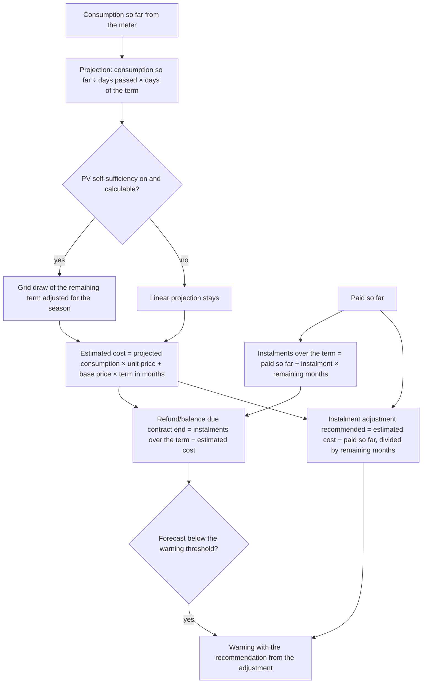

[🇩🇪 Deutsch](Abschlaege-und-Kosten) · 🇬🇧 English

# Payments and costs

This page explains how Tariffy works out the cost so far, the balance, the forecast at the contract end and the recommended instalment from the instalment, the payment interval and the measured consumption. It is for everyone who wants to know where the numbers on the sensors and in the panel come from.

**Contents:**
- [The terms at a glance](#the-terms-at-a-glance)
- [Instalment and payment interval](#instalment-and-payment-interval)
- [Cost so far and balance today](#cost-so-far-and-balance-today)
- [Forecast at contract end](#forecast-at-contract-end)
- [Recommended instalment](#recommended-instalment)
- [Warning for a low instalment](#warning-for-a-low-instalment)
- [Total cost over all terms](#total-cost-over-all-terms)
- [Example](#example)
- [See also](#see-also)

## The terms at a glance

Four sensors have a currency as their unit. Behind them are two questions: **When?** (the standing until today or the forecast for the contract end) and **What?** (a plain amount or the balance of instalments minus costs).

|  | **plain amount** | **balance (paid minus cost)** |
|---|---|---|
| **So far** | Cost (so far) | Refund/balance due (so far) |
| **Contract end** | Installment total (contract term) | Refund/balance due (contract end) |

- **Positive** means credit, **negative** means balance due. The attribute `tendenz` and the icon (thumb up or down) show it as well.
- **Installment total (contract term)** is **not** a cost forecast. It is only the payment plan: instalment times the term in months.
- **Cost (so far)** exists as a sensor for electricity (also dual tariff) and gas. The balance at the contract end exists for all contracts, but only has a value with a consumption sensor, a unit price and an instalment. The lists of all sensors are in the [Sensor-Reference](EN-Sensor-Reference).

| Term | Meaning |
|---|---|
| **Instalment** | the monthly amount you pay to the provider |
| **Paid so far** | the instalments that were due until today (**Instalments paid** in the panel, not a sensor of its own) |
| **Cost so far** | what your consumption has really cost until today |
| **Balance today** | paid so far minus cost so far (**Balance today** in the panel) |
| **Forecast at contract end** | the expected balance at the contract end |
| **Instalment adjustment (recommended)** | the instalment that balances out exactly from today until the contract end |
| **Monthly payment (recommended)** | recommendation for the next term, from the consumption of the last one |
| **Total cost** | cost over all terms of the contract (in the panel, not a sensor) |

## Instalment and payment interval

**Metered contracts** (electricity, gas, water): the **instalment** is always the amount **per month**.

**Flat-rate contracts** (internet, mobile, streaming, insurance, leasing, other): the form asks for the **payment interval** (**Monthly**, **Quarterly**, **Half-yearly**, **Yearly**) and the **amount per payment (€)**. Tariffy stores the amount per month from that. For a payment that is not monthly there is also **Date of the first debit** (empty: contract start). The further debits follow at the distance of the payment interval.

Calculation rules:

- **Term in months** = days from contract start to contract end ÷ 30.44. Without a contract end Tariffy uses 12 months.
- **Installment total (contract term)** = instalment × term in months.
- **Paid so far** for metered contracts = instalment × months since the contract start (days ÷ 30.44, at most the term).
- **Paid so far** for flat-rate contracts = the sum of the debits that were due until today. For monthly payment an instalment counts as soon as its month has begun. For the other payment intervals every debit counts from its day. For flat-rate contracts this is also the **cost so far**: they have no balance and no forecast.
- **If the instalment changes in the middle of the contract**, Tariffy uses the old amount only until the change and the new one after it. If the instalment is changed through the contract form, it remembers the date and the old value; several changes on the same day count as one. A payment history records it more exactly, see [Payment-History-and-One-off-Items](EN-Payment-History-and-One-off-Items).

## Cost so far and balance today

```
Cost so far   = consumption so far × unit price + base price × months passed
Balance today = paid so far − cost so far + one-off items of the running term
```

- **Consumption so far** comes from the meter, see [Measuring-Consumption](EN-Measuring-Consumption). For **gas** it is converted to kWh with **calorific value × state number**, provided both are entered.
- **Months passed** = days since the contract start ÷ 30.44.
- The **unit price** is the fixed price. For a **dynamic tariff** (price sensor) it is the statistics mean of the price sensor since the contract start plus the markup, and the fixed price while there are no statistics yet. For a **dual-tariff meter** it is the average of both prices weighted by consumption. For **water** the combined price of fresh water and wastewater applies, with outdoor meters the weighted price.
- **One-off items** (bonus, bill) only change the balance, not the cost so far. See [Payment-History-and-One-off-Items](EN-Payment-History-and-One-off-Items).
- Without a unit price or without consumption there is neither cost nor balance.

> **Good to know:** Tiered pricing and the night rate do not enter this calculation. Cost so far, balance and forecast use the one unit price of the contract.

## Forecast at contract end

The forecast assumes that the consumption goes on at the same pace as so far. It needs a consumption sensor, a unit price and an instalment.



*Figure: Calculation path from the projection to the recommended instalment, as Tariffy runs it in the coordinator. The warning is only active if you have switched it on.*

As formulas:

```
Projection              = consumption so far ÷ days passed × days of the contract term
Estimated cost          = projection × unit price + base price × term in months
Instalments over term   = paid so far + instalment × (term in months − months so far)
Refund/balance due (contract end) = instalments over term − estimated cost
```

- The days of the contract term are contract end minus contract start, 365 without a contract end.
- If [PV-Self-Sufficiency](EN-PV-Self-Sufficiency) is switched on and calculable, the adjusted grid draw replaces the linear projection. The attribute `prognose_ohne_autarkie` on the sensor shows the forecast without this adjustment.
- **One-off items** do **not** enter the forecast. It is a pure consumption calculation.
- The projection exists from the second day of the contract and with a consumption above zero.

## Recommended instalment

There are two recommendations that are easily confused.

**Instalment adjustment (recommended)** runs along during the current contract:

```
Instalment adjustment (recommended) = (estimated cost − paid so far) ÷ remaining months
```

This is the monthly instalment that balances out exactly from today until the contract end. The calculation exists as long as there are remaining months. The attributes `aktueller_abschlag` and `differenz` on the sensor show the distance to your instalment. The panel adds the hint **Raise the instalment to … per month**, **Instalment could drop to … per month**, **The instalment fits** (distance below 0.50 €) or **No instalment needed: the credit covers the costs until the contract ends**. In the table in the tab **Costs** the column **Recommended** then shows no negative amount but **0.00 €** with the addition **Credit covers the costs**.

**Monthly payment (recommended)** only exists after a tariff switch. It is based on the consumption of the **last** term, which Tariffy freezes at the switch:

```
Monthly payment (recommended) = (consumption last term × unit price + base price × months) ÷ months
```

`months` is the real duration of the term that ended (12 for older, previously frozen values). For gas the consumption is converted to kWh with calorific value × state number. Unit price and base price are those of the new contract. The attributes of the sensor are `verbrauch_letzte_laufzeit`, `verbrauch_letzte_laufzeit_monate`, `aktueller_abschlag` and `differenz`.

If a contract has both, the column **Recommended** in the panel shows the **Monthly payment (recommended)**.

## Warning for a low instalment

A warning can be switched on per contract (electricity, gas, water with a consumption sensor):

1. In the contract form switch on **Warn if instalment is too low** (off by default).
2. Set the **Warning threshold (€ balance due)**. Default: 50 €.
3. If the forecast at the contract end falls below minus the threshold, a persistent notification appears in Home Assistant and, if a notification service is set up, a push message once. It names the expected balance due and the recommendation from **Instalment adjustment (recommended)**, if it can be calculated.
4. The button **Confirm low-instalment warning** (in the panel **Acknowledge warning**) hides the message. If the forecast recovers and later falls below the threshold again, Tariffy warns again.

The raw state is the attribute `abschlag_warnung_aktiv` on the sensor **Refund/balance due (contract end)**.

## Total cost over all terms

In the panel the contract details show **Total cost**, with **since** the start of the first term and the number of terms. There is no sensor for it, and the row only appears if the contract has earlier terms or one-off items.

```
Total cost = cost of the earlier terms (history)
           + cost so far of the running term
           − sum of all one-off items
```

- For earlier terms their **cost** counts, if it is missing their **instalments paid**.
- For the running term the **cost so far** counts, for flat-rate contracts the instalments due until today.
- A bonus (positive) lowers the total cost, a bill (negative) raises it.
- An archived contract counts its last term only once, from the history.
- If a term has no amount at all, **at least** is shown before the value, because the sum is then incomplete.
- Loans are kept apart and do not count in the totals of the contracts.

## Example

This example comes from the sample data of the panel (reference date 12 July 2026, contract Strom Haus). These are the same numbers as in the screenshot.

<table align="center"><tr><td align="center" width="50%"><br><sub>Dark</sub></td><td align="center" width="50%"><br><sub>Light</sub></td></tr></table>

*Figure: Costs tab with the sample data of 12 July 2026. The first row is the contract Strom Haus.*

Data: contract 1 Jan to 31 Dec 2026 (364 days), instalment 40 €/month, unit price 0.2977 €/kWh, base price 11.51 €/month. 192 days have passed (6.31 months), the term has 11.96 months, the meter has counted 1,481.17 kWh. Two one-off items: switching bonus +80 € and broker fee −25 €.

```
Cost so far          = 1,481.17 kWh × 0.2977 € + 11.51 € × 6.31 months           =  513.54 €
Paid so far          = 40 € × 6.31 months                                        =  252.30 €
Balance without items = 252.30 € − 513.54 €                                      = −261.24 €
One-off items        = +80 € − 25 €                                              =  +55.00 €
Balance today        = −261.24 € + 55.00 €                                       = −206.24 €

Projection           = 1,481.17 kWh ÷ 192 days × 364 days                        = 2,808.1 kWh
Estimated cost       = 2,808.1 kWh × 0.2977 € + 11.51 € × 11.96 months           =  973.61 €
Instalments over term = 252.30 € + 40 € × (11.96 − 6.31) months                  =  478.32 €
Forecast at contract end = 478.32 € − 973.61 €                                   = −495.29 €

Adjustment recommended = (973.61 € − 252.30 €) ÷ (11.96 − 6.31) months           =  127.66 € per month
```

So the instalment would have to rise to about **127.66 €** for nothing to be open at the contract end. The panel adds **Raise the instalment to 127.66 € per month**. The forecast does not contain the one-off items; it stays at −495.29 €. **Total cost** is 1,042.50 € + 1,166.20 € (the two earlier terms) + 513.54 € − 55.00 € = **2,667.24 €**, since 1 Jan 2024 over three terms.

For comparison, the recommendation after a tariff switch: if 3,000 kWh were consumed over 12 months in the last term, a unit price of 0.2977 € and a base price of 11.51 € give as **Monthly payment (recommended)** `(3,000 × 0.2977 + 11.51 × 12) ÷ 12 = 85.94 €`.

## See also

- [Measuring-Consumption](EN-Measuring-Consumption): where the consumption comes from
- [PV-Self-Sufficiency](EN-PV-Self-Sufficiency): forecast with photovoltaics
- [Payment-History-and-One-off-Items](EN-Payment-History-and-One-off-Items): instalments by payment and bonus or bill
- [Sensor-Reference](EN-Sensor-Reference): all sensors
- [Panel-Costs](EN-Panel-Costs): the Costs tab in the panel
- [Contract-End-and-Switching](EN-Contract-End-and-Switching): tariff switch and reminders
