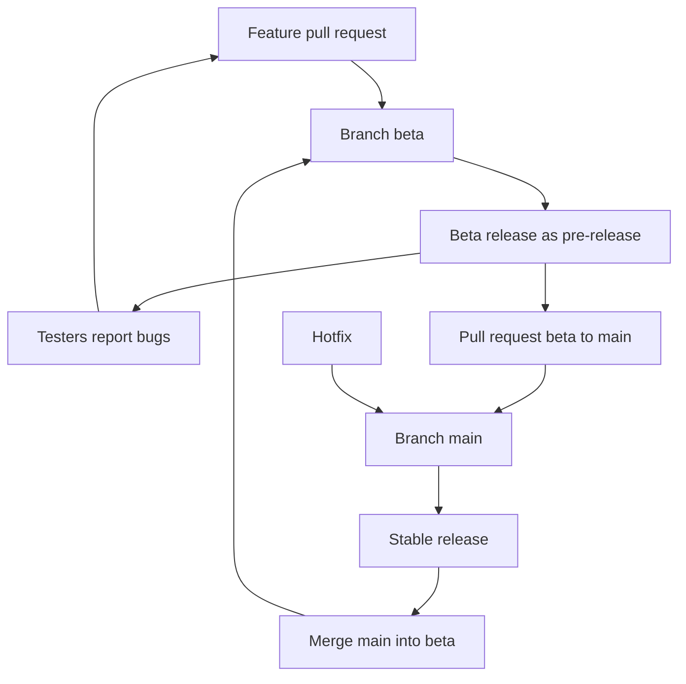

[🇩🇪 Deutsch](Releases-und-Beta) · 🇬🇧 English

# Releases and Beta

Tariffy has two kinds of versions: **Stable** for everyone and **Beta** for those who want to test new things early. This page explains the difference, shows how to enable beta versions in HACS and describes the path of a version for contributors.

**Contents:**
- [Stable, Beta and RC](#stable-beta-and-rc)
- [Enable beta in HACS](#enable-beta-in-hacs)
- [Read the changes](#read-the-changes)
- [The path of a version](#the-path-of-a-version)
- [Rules for contributors](#rules-for-contributors)

## Stable, Beta and RC

Unfinished work is published as a **beta pre-release**, so normal users do not get it by accident. Without **Show beta versions** HACS only offers stable versions. A beta never replaces the stable version for anyone who did not opt in.

| | Stable | Beta |
|---|---|---|
| Branch | `main` | `beta` |
| Version in `manifest.json` | `1.32.0` | `1.32.0-beta.1` to `-beta.9`, then `-rc.1` to `-rc.9` |
| Changelog section | `## [1.32.0]` | `## [1.32.0-beta.1]` |
| GitHub release | normal, marked "Latest" | **pre-release**, never marked "Latest" |

**RC** stands for release candidate: a beta series counts up to `beta.9` and then continues with `rc.1`. Version 1.32.0 is an example: it brings together everything that was tested in `1.32.0-beta.1` to `1.32.0-beta.9` and `1.32.0-rc.1` to `1.32.0-rc.3`.

## Enable beta in HACS

1. Open HACS and search for **Tariffy**.
2. Open the ⋮ menu at the top right and choose **Redownload**.
3. Switch on **Show beta versions**.
4. Pick a version like `1.33.0-beta.1` (example) and download it.
5. Restart Home Assistant.
6. Hard-reload the browser page (Ctrl+F5), because the panel may have changed.
7. Report problems with the form "Bug Report" and name the exact beta version (see [Troubleshooting](EN-Troubleshooting#write-a-bug-report)).

The labels are written here as the project names them; depending on the language and version of HACS they may differ.

To go back to stable, follow the same steps, switch **Show beta versions** off and pick the newest stable version.

## Read the changes

Every version has a section in the [CHANGELOG](https://github.com/weskona/tariffy/blob/main/CHANGELOG.md), divided into "Added", "Changed" and "Fixed". The same texts are the description of the GitHub release: the release description is generated from the changelog section of the version. You find all releases on the [releases page](https://github.com/weskona/tariffy/releases).

## The path of a version

*Figure: Feature pull requests land in `beta` and are published as a pre-release. A pull request from `beta` to `main` publishes the stable version. Hotfixes go straight to `main`, afterwards `main` is merged into `beta`.*

## Rules for contributors

The `Release` workflow runs on pushes to `main` and `beta` and reads the version from `manifest.json`. A version without a release gets a tag, a release and `tariffy.zip`.

- A version on the wrong branch is **skipped** (a stable version on `beta`, a beta version on `main`), so merging `main` into `beta` never publishes anything. The rules live in `.github/scripts/release-plan.sh` and are tested in `.github/scripts/test-release-plan.sh`.
- **Never count above 9 (`beta.10`, `rc.10`):** GitHub sorts the tag names of its release list as text, so `beta.10` lands between `beta.2` and `beta.1`, and HACS then does not offer it. After `beta.9` continue with `rc.1` (`rc` sorts after `beta`); when a series runs out, start a new series with a letter that sorts later or release the stable version. `tests/test_version.py` guards this.
- **One pull request per beta:** a feature pull request into `beta` also raises the version in `manifest.json` and moves its `Unreleased` changelog entries into the new section. Merging it publishes the beta, so there is no separate version pull request.
- `main` is merged into `beta` only after a stable release (or when a fix from `main` is needed in the beta), not after every hotfix.
- Hotfixes for stable users go to `main` and are released from there. They never contain unfinished beta code. Merge `main` into `beta` afterwards.
- To promote a beta, merge `beta` into `main` through a pull request, set the stable version and changelog section there, and merge. The workflow then publishes the stable release.
- The `Release` workflow can be run manually with `dry_run`: it then builds the zip and the release notes but publishes nothing.
- There are two changelogs per version, `CHANGELOG.md` in the root and `custom_components/tariffy/CHANGELOG.md`.

> **Good to know:** The release notes need a changelog section with exactly the version as its heading. If it is missing or empty, the script `.github/scripts/release-notes.sh` stops, so a release never ships without notes.

## See also

- [Development](EN-Development)
- [Troubleshooting](EN-Troubleshooting)
- [FAQ](EN-FAQ)
