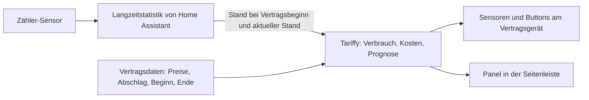

🇩🇪 Deutsch · [🇬🇧 English](EN-Getting-Started)

# Erste Schritte

Diese Seite führt Dich von der Installation bis zum ersten Vertrag: Tariffy über HACS installieren, die Integration hinzufügen, einen Vertrag anlegen und im Panel wiederfinden. Du brauchst dafür etwa fünf Minuten.

**Inhalt:**

- [Voraussetzungen](#voraussetzungen)
- [Installation über HACS](#installation-über-hacs)
- [Beta-Versionen aktivieren](#beta-versionen-aktivieren)
- [Manuelle Installation](#manuelle-installation)
- [Integration hinzufügen](#integration-hinzufügen)
- [Der erste Vertrag in fünf Minuten](#der-erste-vertrag-in-fünf-minuten)
- [Vom Zähler zum Panel](#vom-zähler-zum-panel)
- [Das Panel in der Seitenleiste](#das-panel-in-der-seitenleiste)
- [So sieht ein Vertrag in Home Assistant aus](#so-sieht-ein-vertrag-in-home-assistant-aus)

## Voraussetzungen

- Home Assistant 2026.6 oder neuer.
- HACS (für die bequeme Installation und spätere Updates).
- Für echte Verbrauchsmessung ein Zähler-Sensor mit Langzeitstatistik, zum Beispiel ein Sensor aus dem Energie-Dashboard. Ohne Zähler-Sensor funktioniert Tariffy trotzdem, rechnet dann aber keinen Verbrauch.

## Installation über HACS

1. Öffne in Home Assistant **HACS → Integrationen → ⋮ → Benutzerdefinierte Repositories**.
2. Trage als URL `https://github.com/weskona/tariffy` ein und wähle die Kategorie **Integration**.
3. Installiere **Tariffy** und starte Home Assistant neu.
4. Gehe zu **Einstellungen → Geräte & Dienste** und füge **Tariffy** hinzu (siehe [Integration hinzufügen](#integration-hinzufügen)).

HACS bietet Dir normalerweise nur stabile Versionen an. Updates meldet HACS wie bei jeder anderen Integration.

## Beta-Versionen aktivieren

Unfertige Arbeit wird als Beta-Vorabversion veröffentlicht, damit normale Nutzer sie nie aus Versehen bekommen. Wenn Du testen möchtest:

1. Öffne **HACS → Tariffy → ⋮ → Redownload** und schalte **Show beta versions** ein (so heißen die Einträge in HACS).
2. Wähle eine Version wie `1.27.0-beta.1` und starte Home Assistant neu.
3. Meldest Du ein Problem, nenne die genaue Beta-Version.

Ohne diese Einstellung bietet HACS nur stabile Versionen an; eine Beta ersetzt die stabile Version nie bei jemandem, der sich nicht dafür entschieden hat. Mehr dazu unter [Releases und Beta](Releases-und-Beta).

## Manuelle Installation

Kopiere den Ordner `custom_components/tariffy` nach `/config/custom_components/` und starte Home Assistant neu:

```bash
cp -r custom_components/tariffy /config/custom_components/
```

## Integration hinzufügen

Jeder Vertrag ist bei Tariffy ein eigener Eintrag der Integration. Du legst also die Integration für jeden Vertrag einmal an:

1. Öffne **Einstellungen → Geräte & Dienste**.
2. Klicke auf **Integration hinzufügen** und suche **Tariffy**.
3. Es öffnet sich das Formular **Neuen Vertrag anlegen** („Allgemeine Vertragsdaten.“). Pflichtfelder sind **Bezeichnung (z. B. Strom Haus)**, **Sparte**, **Anbieter** und **Kündigung erinnern**.
4. Je nach **Sparte** folgt ein zweites Formular mit den Preisen und Zählerdaten (bei manchen Sparten ein dritter Schritt). Mit dem Speichern des letzten Schritts ist der Vertrag angelegt.

Weitere Verträge legst Du genauso an, oder im Panel mit dem Button **Neuer Vertrag** (nur Administratoren, siehe unten).

## Der erste Vertrag in fünf Minuten

Als Beispiel legen wir einen Stromvertrag an. Die Zahlen stammen aus dem Beispiel-Vertrag „Strom Haus“, den auch die Screenshots im Wiki verwenden (Mock-Daten, Datum 12.07.2026).

**Schritt 1: Allgemeine Vertragsdaten**

| Feld | Eingabe im Beispiel |
|---|---|
| Bezeichnung (z. B. Strom Haus) | Strom Haus |
| Sparte | Strom |
| Anbieter | Stadtwerke Nord |
| Tarifname | Öko Fix 12 |
| Vertragsbeginn | 01.01.2026 |
| Vertragsende / Laufzeit bis | 31.12.2026 |
| Kündigung erinnern | 3 Monate vorher (Voreinstellung) |

Alle anderen Felder sind optional. Eine Übersicht aller allgemeinen Felder steht unter [Verträge anlegen](Vertraege-Anlegen).

**Schritt 2: Strom-Details**

| Feld | Eingabe im Beispiel |
|---|---|
| Arbeitspreis (€/kWh) | 0,2977 |
| Grundpreis (€/Monat) | 11,51 |
| Monatlicher Abschlag (€/Monat) | 40 |
| Verbrauchssensor (optional) | Dein Zähler-Sensor, im Beispiel `sensor.strom_haus` |

Die Preise findest Du auf Deiner Rechnung. Den **Verbrauchssensor** brauchst Du, damit Tariffy den echten Verbrauch seit Vertragsbeginn misst; ohne ihn bleiben Kosten, Saldo und Prognose leer. Alle Felder erklärt [Vertrag Strom](Vertrag-Strom).

**Schritt 3: Speichern**

Speichere das Formular. Tariffy legt das Gerät mit seinen Sensoren an und liest den Zählerstand zum Vertragsbeginn aus den Langzeitstatistiken. Nach dem ersten Update stehen die Werte im Panel und bei den Sensoren. Die Werte werden alle 6 Stunden, um 00:00:01 Uhr und nach dem Start von Home Assistant aktualisiert.

Im Beispiel ergibt das (Zählerstand 1.481,17 kWh seit Beginn, Stand 12.07.2026): Kosten bisher 513,54 €, Saldo heute −261,24 € (Nachzahlung), Prognose zum Vertragsende −495,29 €. Die Rechnung steht Schritt für Schritt unter [Vertrag Strom](Vertrag-Strom#rechenbeispiel).

> **Gut zu wissen:** Brauchst Du keine Verbrauchsmessung (zum Beispiel bei Internet oder Versicherung), wählst Du eine andere Sparte. Dort gibst Du nur Betrag und Zahlweise an. Die Sparten sind unter [Verträge anlegen](Vertraege-Anlegen#alle-sparten-im-überblick) aufgelistet.

## Vom Zähler zum Panel

Tariffy misst nicht selbst, sondern rechnet mit dem, was Home Assistant über Deinen Zähler weiß. Aus den Langzeitstatistiken liest Tariffy den Zählerstand am Vertragsbeginn und den aktuellen Stand; die Differenz ist der Verbrauch seit Vertragsbeginn. Zusammen mit den Preisen aus dem Vertrag ergeben sich Kosten, Saldo und Prognose.



*Abbildung: Der Weg vom Zähler-Sensor über Tariffy zu den Sensoren und zum Panel.*

Wichtig dabei:

- Tariffy liest vor allem die kumulierte Summe (`sum`) der Langzeitstatistik, nicht nur den rohen Sensorwert. Das macht die Rechnung robust gegen Zähler, die zwischendurch auf null zurückspringen.
- Reicht die Statistik nicht bis zum Vertragsbeginn zurück, trägst Du im Formular einen **Zählerstand bei Vertragsbeginn (optional)** ein; er hat Vorrang.
- Meldet Dein Zähler in Wh oder MWh, rechnet Tariffy in kWh um.

Mehr dazu auf der Seite [Verbrauch messen](Verbrauch-Messen).

## Das Panel in der Seitenleiste

Sobald mindestens ein Vertrag geladen ist, erscheint in der Seitenleiste von Home Assistant der Eintrag **Tariffy** (Symbol `mdi:cash-multiple`). Das Panel gehört zur Integration; es gibt nichts zu installieren. Nach einem Update lädst Du die Browserseite einmal hart neu (Strg+F5), damit die neue Panel-Datei geladen wird.

Das Panel hat fünf Ansichten: **Übersicht**, **Kosten**, **Verträge**, **Historie** und **Sicherung** (die Sicherung sehen nur Administratoren). Den Vertrag legst Du im Tab **Verträge** an; dort stehen auch alle Aktionen, die einen Vertrag ändern.

<p align="center"><picture><source media="(prefers-color-scheme: dark)" srcset="https://raw.githubusercontent.com/wiki/weskona/tariffy/images/desktop-contracts.png"></picture></p>

*Abbildung: Der Tab „Verträge“ mit dem Button „Neuer Vertrag“ (Mock-Daten, Datum 12.07.2026).*

Auf dem Handy werden die Karten zu aufklappbaren Zeilen:

<p align="center"><picture><source media="(prefers-color-scheme: dark)" srcset="https://raw.githubusercontent.com/wiki/weskona/tariffy/images/mobile-overview.png"></picture></p>

*Abbildung: Die Übersicht auf dem Handy.*

Alles Weitere zum Panel steht unter [Panel Übersicht](Panel-Uebersicht) und [Panel Verträge](Panel-Vertraege).

> **Gut zu wissen:** Alle Benutzer sehen das Panel, aber nur Administratoren dürfen Verträge anlegen, bearbeiten und löschen. Was wer sieht, erklärt [Panel Rechte und Design](Panel-Rechte-und-Design).

## So sieht ein Vertrag in Home Assistant aus

Jeder Vertrag wird ein eigenes **Gerät** in Home Assistant:

- **Name:** die Bezeichnung, die Du eingegeben hast (zum Beispiel „Strom Haus“).
- **Hersteller:** der Anbieter.
- **Modell:** die Sparte (zum Beispiel „Electricity“, beim Zweizählertarif „Electricity (HT/NT)“).
- **Sensoren:** Preise, Abschlag, Verbrauch, Kosten, Saldo, Prognose, Restlaufzeit und weitere. Anbieter, Kundennummer, Tarif und Zählernummer sind Diagnose-Sensoren. Welche Sensoren es bei welcher Sparte gibt, listet [Sensoren Referenz](Sensoren-Referenz).
- **Buttons:** **Jetzt wechseln** (nur verfügbar, wenn ein nächster Vertrag geplant ist), **Kündigung bestätigen** (nur während die Kündigungs-Erinnerung aktiv ist) und **Abschlag-Warnung bestätigen** (nur bei offener Warnung).

Die Entity-IDs entstehen aus dem Namen des Geräts und dem Namen des Sensors (zum Beispiel `sensor.strom_haus_arbeitspreis`); Deine IDs können abweichen.

## Siehe auch

- [Verträge anlegen](Vertraege-Anlegen): alle Sparten, allgemeine Felder, Bearbeiten und Löschen
- [Vertrag Strom](Vertrag-Strom), [Vertrag Gas](Vertrag-Gas), [Vertrag Wasser](Vertrag-Wasser)
- [Verbrauch messen](Verbrauch-Messen)
- [Panel Übersicht](Panel-Uebersicht)
- [Releases und Beta](Releases-und-Beta)
- [Fehlerbehebung](Fehlerbehebung)
