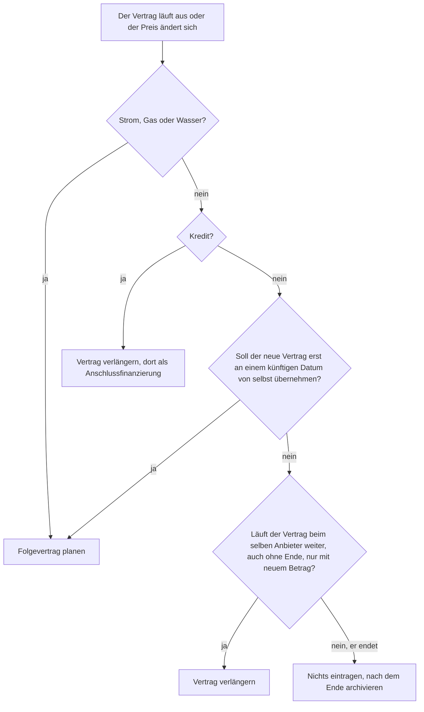

🇩🇪 Deutsch · [🇬🇧 English](EN-Next-Contract-or-Renew)

# Folgevertrag oder Verlängern

Läuft ein Vertrag aus, kennt Tariffy zwei Wege weiter: den **Folgevertrag**, der zu einem Datum von selbst übernimmt, und das **Verlängern**, bei dem derselbe Vertrag mit neuem Beginn, Ende und Betrag weiterläuft. Diese Seite hilft Dir bei der Wahl und zeigt, was sich danach in den Sensoren ändert.

**Inhalt:**

- [Welchen Weg nehme ich?](#welchen-weg-nehme-ich)
- [Die Unterschiede im Überblick](#die-unterschiede-im-überblick)
- [Was sich in den Sensoren ändert](#was-sich-in-den-sensoren-ändert)
- [Beispiel mit Zahlen](#beispiel-mit-zahlen)

## Welchen Weg nehme ich?



Kurz gesagt:

- **Strom, Gas, Wasser:** immer Folgevertrag. Verlängern gibt es hier nicht.
- **Pauschalvertrag mit neuem Anbieter oder Tarif ab einem festen Tag:** Folgevertrag. Du trägst ihn heute ein, Tariffy schaltet am Wechseltag um.
- **Pauschalvertrag, der beim selben Anbieter einfach weiterläuft** (neuer Beitrag, Preisanpassung, auch bei einem Vertrag ohne Ende): Verlängern. Es gilt sofort, wenn Du speicherst.
- **Kredit:** Anschlussfinanzierung über **Vertrag verlängern**.
- **Der Vertrag endet und nichts folgt:** nichts eintragen. Nach dem Ende kannst Du ihn archivieren (siehe [Archiv-und-Historie](Archiv-und-Historie)).

## Die Unterschiede im Überblick

| | Folgevertrag | Verlängern |
|---|---|---|
| Für welche Verträge | alle Sparten, im Panel außer Kredit | Verträge ohne Verbrauchszähler (Internet, Mobilfunk, Streaming, Versicherung, Leasing, Kredit, Sonstiges), nicht archiviert |
| Wann wirkt es | am Wechseldatum von selbst, oder sofort mit dem Button **Jetzt wechseln** | sofort beim Speichern |
| Was Du eingibst | nur, was sich ändert; leere Felder behalten den Wert des laufenden Vertrags | Beginn, Ende (darf leer sein), Zahlweise, Betrag pro Zahlung, optional Erste Abbuchung |
| Alte Laufzeit | kommt in die Historie | kommt in die Historie |
| Verbrauch der alten Laufzeit | wird bei Strom, Gas und Wasser eingefroren | entfällt (Pauschalverträge haben keinen Verbrauch) |
| Erinnerung | beginnt zum neuen Ende von vorn | beginnt zum neuen Ende von vorn |
| Mindestlaufzeit | wird nicht übernommen | bleibt erhalten |
| Abschlagsverlauf | wird nicht übernommen | gehört zur alten Laufzeit und beginnt von vorn |
| Wo | Panel (Tab **Verträge**) oder **Optionen** in Home Assistant, **Jetzt wechseln** nur in Home Assistant | Panel (Tab **Verträge**) |

Mehr zu den einzelnen Schritten steht auf [Vertragsende-und-Wechsel](Vertragsende-und-Wechsel).

> **Gut zu wissen:** Beide Wege legen die alte Laufzeit in der Historie ab. In den **Kosten gesamt** über alle Laufzeiten zählt sie weiter mit; die Sensoren des laufenden Vertrags („Kosten (Bisher)" und so weiter) beginnen dagegen mit dem neuen Beginn von vorn.

## Was sich in den Sensoren ändert

### Nach einem Folgevertrag (Strom, Gas, Wasser)

Zum Wechsel passiert in den Sensoren des Vertrags Folgendes:

- Der Zähler-Startpunkt wird zurückgesetzt. **Verbrauch (Bisher)** und die Kosten zählen ab dem neuen Beginn von null.
- **Verbrauch (Letzte Laufzeit)** zeigt jetzt den **eingefrorenen** Verbrauch der alten Laufzeit. Er bleibt stehen, auch beim Bearbeiten des Vertrags. Kann beim nächsten Wechsel kein neuer Wert bestimmt werden, bleibt der alte erhalten.
- **Abschlag (Empfohlen)** wird berechnet. Vorher ist der Sensor leer (ohne letzte Laufzeit gibt es nichts zu empfehlen). Er hat die Attribute `verbrauch_letzte_laufzeit`, `verbrauch_letzte_laufzeit_monate`, `aktueller_abschlag` und `differenz`.
- Die Sensoren **Abschlag (Anpassung empfohlen)** und **Guthaben/Nachzahlung (Vertragsende)** laufen mit den Daten des neuen Vertrags weiter.

So rechnet **Abschlag (Empfohlen)**:

```text
Abschlag (Empfohlen) = (Verbrauch letzte Laufzeit × Arbeitspreis + Grundpreis × Monate) / Monate
```

- Der **Arbeitspreis** und der **Grundpreis** sind die des **neuen** Vertrags. Bei Gas wird der Verbrauch vorher mit Brennwert und Zustandszahl in kWh umgerechnet, bei Wasser gilt der Preis inklusive Abwasser.
- **Monate** ist die tatsächliche Dauer der alten Laufzeit (Tage geteilt durch 30,44, auf zwei Stellen gerundet). Fehlt die Dauer (bei älteren eingefrorenen Werten), rechnet Tariffy mit 12 Monaten.

### Nach dem Verlängern (Pauschalverträge)

- **Abschlag** und die Jahreswerte zeigen den neuen Betrag; gespeichert wird immer der Monatsbetrag, der Betrag pro Zahlung ergibt sich aus der Zahlweise.
- Die bisher gezahlten Abschläge zählen ab dem neuen Beginn. Bei jährlicher Zahlung ist die neue Prämie mit der Abbuchung zum neuen Beginn fällig.
- **Restlaufzeit** und das Erinnerungsdatum richten sich nach dem neuen Ende. Ohne neues Ende gibt es keine Restlaufzeit und keine Erinnerung.
- Die alte Laufzeit steht in der Historie mit ihrem Abschlag und den gezahlten Abschlägen. Bei jedem weiteren Verlängern kommt eine Zeile dazu, so siehst Du, wie sich der Beitrag entwickelt.
- Es gibt weder eingefrorenen Verbrauch noch einen empfohlenen Abschlag, denn Pauschalverträge haben keinen Verbrauch.

> **Gut zu wissen:** Nach einem Folgevertrag sind die Prognosen am Anfang noch dünn, denn die Hochrechnung braucht Messwerte der neuen Laufzeit. Der Sensor **Abschlag (Empfohlen)** hilft in dieser Zeit: Er beruht auf dem vollständigen Verbrauch der alten Laufzeit.

## Beispiel mit Zahlen

### Strom: Folgevertrag

Beispiel: Der Stromvertrag läuft vom 01.01.2026 bis 31.12.2026 mit 0,2977 €/kWh, 11,51 € Grundpreis und 40 € Abschlag. Du hast einen Folgevertrag ab 01.01.2027 mit 0,25 €/kWh und 55 € Abschlag eingetragen, den Grundpreis hast Du leer gelassen.

1. Am 01.01.2027 schaltet Tariffy um. Der Grundpreis bleibt bei 11,51 €, der Arbeitspreis ist 0,25 €/kWh, der Abschlag 55 €.
2. Angenommen, die alte Laufzeit hatte 3000 kWh verbraucht (Beispielwert). **Verbrauch (Letzte Laufzeit)** zeigt 3000 kWh.
3. Die alte Laufzeit dauerte 365 Tage, das sind 365 / 30,44 = 11,99 Monate.
4. **Abschlag (Empfohlen)** = (3000 × 0,25 + 11,51 × 11,99) / 11,99 = 74,06 €. Der aktuelle Abschlag von 55 € liegt darunter; das Attribut `differenz` zeigt entsprechend 19,06.

### Versicherung: Verlängern

Beispiel (nach den Tests der Integration): Eine Versicherung läuft vom 01.01.2025 bis 31.12.2025, die Prämie beträgt jährlich 600 €, also 50 € pro Monat. Du verlängerst mit Beginn 01.01.2026, Ende 31.12.2026 und einem Betrag pro Zahlung von 660 €, Zahlweise Jährlich.

- Der Dialog zeigt „10,0 % teurer" (55,00 € statt 50,00 € pro Monat).
- Die alte Laufzeit steht in der Historie: 01.01.2025 bis 31.12.2025, Abschlag 50 €, gezahlt 600 €.
- Der Vertrag hat jetzt einen Abschlag von 55 € pro Monat, 660 € pro Jahr, und die Prämie von 660 € gilt zum neuen Beginn als gezahlt.
- Hatte der Vertrag eine Erinnerung „3 Monate vorher", liegt das neue Erinnerungsdatum am 30.09.2026.

## Siehe auch

- [Vertragsende-und-Wechsel](Vertragsende-und-Wechsel): Erinnerung, Folgevertrag, Verlängern und die Buttons
- [Archiv-und-Historie](Archiv-und-Historie): Die Historie und das Archiv
- [Abschlaege-und-Kosten](Abschlaege-und-Kosten): Empfohlener Abschlag und Kostenrechnung
- [Sensoren-Referenz](Sensoren-Referenz): Alle Sensoren und ihre Attribute
- [Vertrag-Kredit](Vertrag-Kredit): Anschlussfinanzierung
