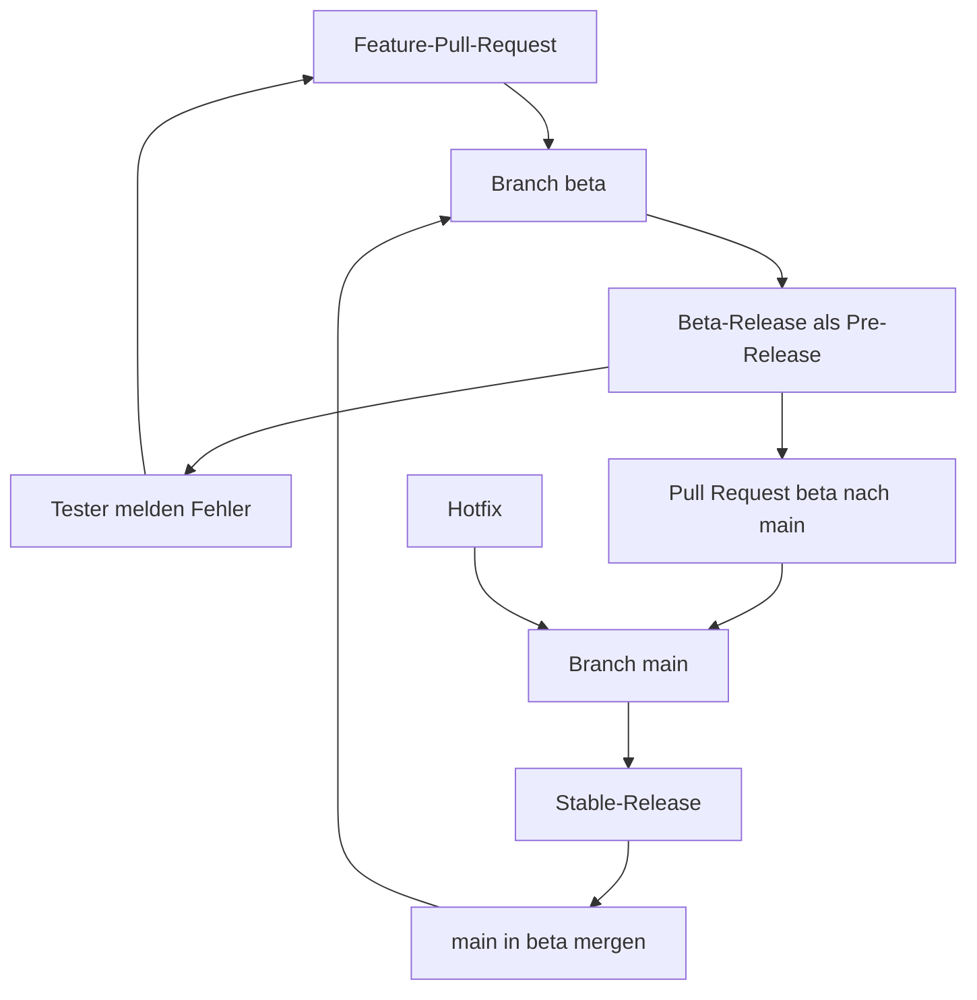

🇩🇪 Deutsch · [🇬🇧 English](EN-Releases-and-Beta)

# Releases und Beta

Tariffy hat zwei Arten von Versionen: **Stable** für alle und **Beta** für alle, die Neues vorab testen wollen. Diese Seite erklärt den Unterschied, zeigt, wie Du in HACS Beta-Versionen einschaltest, und beschreibt für Mitwirkende den Weg einer Version.

**Inhalt:**
- [Stable, Beta und RC](#stable-beta-und-rc)
- [Beta in HACS einschalten](#beta-in-hacs-einschalten)
- [Änderungen nachlesen](#änderungen-nachlesen)
- [Der Weg einer Version](#der-weg-einer-version)
- [Regeln für Mitwirkende](#regeln-für-mitwirkende)

## Stable, Beta und RC

Unfertige Arbeit wird als **Beta-Vorabversion** (Pre-Release) veröffentlicht, damit normale Nutzer sie nicht versehentlich bekommen. Ohne **Show beta versions** bietet HACS nur Stable-Versionen an. Eine Beta ersetzt die Stable-Version nie bei jemandem, der sich nicht dafür entschieden hat.

| | Stable | Beta |
|---|---|---|
| Branch | `main` | `beta` |
| Version in `manifest.json` | `1.32.0` | `1.32.0-beta.1` bis `-beta.9`, danach `-rc.1` bis `-rc.9` |
| Abschnitt im Changelog | `## [1.32.0]` | `## [1.32.0-beta.1]` |
| GitHub-Release | normal, als „Latest" markiert | **Pre-Release**, nie als „Latest" markiert |

**RC** steht für Release Candidate: Eine Beta-Reihe zählt bis `beta.9` und geht dann mit `rc.1` weiter. Die Version 1.32.0 ist ein Beispiel: Sie fasst alles zusammen, was in `1.32.0-beta.1` bis `1.32.0-beta.9` und `1.32.0-rc.1` bis `1.32.0-rc.3` getestet wurde.

## Beta in HACS einschalten

1. Öffne HACS und suche **Tariffy**.
2. Öffne das Menü ⋮ oben rechts und wähle **Redownload**.
3. Schalte **Show beta versions** ein.
4. Wähle eine Version wie `1.33.0-beta.1` (Beispiel) und lade sie herunter.
5. Starte Home Assistant neu.
6. Lade die Browserseite hart neu (Strg+F5), weil sich das Panel ändern kann.
7. Melde Probleme mit dem Formular „Bug Report" und nenne die genaue Beta-Version (siehe [Fehlerbehebung](Fehlerbehebung#fehlerbericht-erstellen)).

Die Bezeichnungen stehen hier so, wie das Projekt sie nennt; je nach Sprache und Version von HACS können sie anders lauten.

Zurück zu Stable kommst Du, indem Du dieselben Schritte gehst, **Show beta versions** ausschaltest und die neueste Stable-Version wählst.

## Änderungen nachlesen

Jede Version hat einen Abschnitt im [CHANGELOG](https://github.com/weskona/tariffy/blob/main/CHANGELOG.md), gegliedert in „Added", „Changed" und „Fixed". Dieselben Texte stehen als Beschreibung im GitHub-Release: Die Release-Beschreibung wird aus dem Changelog-Abschnitt der Version erzeugt. Alle Releases findest Du auf der [Releases-Seite](https://github.com/weskona/tariffy/releases).

## Der Weg einer Version

*Abbildung: Feature-Pull-Requests landen in `beta` und werden als Pre-Release veröffentlicht. Ein Pull Request von `beta` nach `main` veröffentlicht die Stable-Version. Hotfixes gehen direkt nach `main`, danach wird `main` in `beta` gemergt.*

## Regeln für Mitwirkende

Der Workflow `Release` läuft bei Pushes auf `main` und `beta` und liest die Version aus der `manifest.json`. Hat die Version noch kein Release, entstehen Tag, Release und `tariffy.zip`.

- Eine Version auf dem falschen Branch wird **übersprungen** (Stable-Version auf `beta`, Beta-Version auf `main`). Das Mergen von `main` in `beta` veröffentlicht deshalb nichts. Die Regeln stehen in `.github/scripts/release-plan.sh` und werden in `.github/scripts/test-release-plan.sh` getestet.
- **Nie über 9 zählen (`beta.10`, `rc.10`):** GitHub sortiert die Tag-Namen seiner Release-Liste als Text, `beta.10` landet zwischen `beta.2` und `beta.1`, und HACS bietet es dann nicht an. Nach `beta.9` geht es mit `rc.1` weiter (`rc` sortiert nach `beta`); ist eine Reihe voll, beginnt man eine neue mit einem später sortierten Buchstaben oder veröffentlicht die Stable-Version. `tests/test_version.py` prüft das.
- **Ein Pull Request pro Beta:** Ein Feature-Pull-Request nach `beta` hebt auch die Version in `manifest.json` an und verschiebt seine `Unreleased`-Einträge im Changelog in den neuen Abschnitt. Mit dem Merge erscheint die Beta, einen eigenen Versions-Pull-Request gibt es nicht.
- `main` wird nur nach einem Stable-Release in `beta` gemergt (oder wenn ein Fix aus `main` in der Beta gebraucht wird), nicht nach jedem Hotfix.
- Hotfixes für Stable-Nutzer gehen nach `main` und werden von dort veröffentlicht. Sie enthalten nie unfertigen Beta-Code. Danach `main` in `beta` mergen.
- Eine Beta wird zur Stable-Version, indem man `beta` per Pull Request in `main` mergt, dort die Stable-Version und den Changelog-Abschnitt setzt und mergt. Dann veröffentlicht der Workflow das Stable-Release.
- Der Workflow `Release` lässt sich von Hand mit `dry_run` starten: Er baut dann Zip und Release-Notes, veröffentlicht aber nichts.
- Pro Version gibt es zwei Changelogs, `CHANGELOG.md` im Hauptverzeichnis und `custom_components/tariffy/CHANGELOG.md`.

> **Gut zu wissen:** Die Release-Notes brauchen einen Changelog-Abschnitt mit genau der Version als Überschrift. Fehlt er oder ist er leer, bricht das Skript `.github/scripts/release-notes.sh` ab, damit nie ein Release ohne Notizen erscheint.

## Siehe auch

- [Entwickler](Entwickler)
- [Fehlerbehebung](Fehlerbehebung)
- [FAQ](FAQ)
