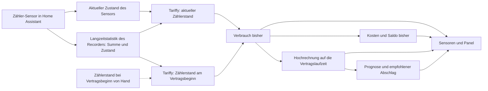

🇩🇪 Deutsch · [🇬🇧 English](EN-Measuring-Consumption)

# Verbrauch messen

Diese Seite erklärt, wie Tariffy mit einem Zähler-Sensor aus Home Assistant den echten Verbrauch seit Vertragsbeginn ermittelt und auf die Vertragslaufzeit hochrechnet. Sie ist für alle gedacht, die bei Strom, Gas oder Wasser Kosten, Saldo und Prognose aus echten Messwerten haben wollen, und für alle, bei denen diese Werte leer bleiben.

**Inhalt:**
- [So fließen die Daten](#so-fließen-die-daten)
- [Verbrauchssensor wählen](#verbrauchssensor-wählen)
- [Einheiten](#einheiten)
- [Zählerstand bei Vertragsbeginn](#zählerstand-bei-vertragsbeginn)
- [Verbrauch bisher und Hochrechnung](#verbrauch-bisher-und-hochrechnung)
- [Wenn Statistiken fehlen](#wenn-statistiken-fehlen)
- [Sonderfälle](#sonderfälle)
- [Checkliste bei fehlenden Daten](#checkliste-bei-fehlenden-daten)
- [Beispiel](#beispiel)
- [Siehe auch](#siehe-auch)

## So fließen die Daten

Tariffy zählt nicht selbst mit. Es liest den Zählerstand aus den **Langzeitstatistiken** (Long-Term Statistics) des Recorders von Home Assistant und vergleicht ihn mit dem Stand am Vertragsbeginn.



*Abbildung: Datenfluss vom Zähler-Sensor bis zu den Sensoren und zum Panel. Die gestrichelte Linie zeigt den Zählerstand bei Vertragsbeginn, den Du selbst eintragen kannst.*

Der Verbrauchssensor ist freiwillig. Ohne ihn rechnet Tariffy mit dem geschätzten Jahresverbrauch aus dem Vertrag und es gibt keine Sensoren für gemessenen Verbrauch, Kosten bisher und Prognose mit echten Werten.

## Verbrauchssensor wählen

Das Feld **Verbrauchssensor (optional)** gibt es in den Vertragsformularen für Strom, Gas, Wasser und Strom (Zweizählertarif). Beim Zweizählertarif kommt **Verbrauchssensor Niedertarif / NT (optional)** für das zweite Register dazu.

1. Öffne den Vertrag zum Bearbeiten: im Panel mit **Vertrag bearbeiten**, in Home Assistant über die Neukonfiguration des Eintrags (Einstellungen, Geräte & Dienste, Tariffy).
2. Wähle bei **Verbrauchssensor (optional)** den Sensor Deines Zählers. Er sollte den **Zählerstand** liefern, der dauernd weiterzählt, nicht den Verbrauch des Tages.
3. Speichere. Home Assistant lädt den Vertrag neu und Tariffy liest die Statistik.
4. Prüfe nach kurzer Zeit, ob **Verbrauch (Bisher)** einen Wert hat (siehe [Sensoren-Referenz](Sensoren-Referenz)).

Damit Kosten, Saldo und Prognose entstehen, braucht der Vertrag außerdem einen **Arbeitspreis**. Der Saldo und die Prognose brauchen zusätzlich einen **Abschlag**.

> **Gut zu wissen:** Tariffy liest die **Summe** (`sum`) der Langzeitstatistik. Home Assistant führt sie für Zähler, die dauernd weiterzählen (typisch `state_class: total_increasing` oder `total`). Ein Sensor, der nur Momentanwerte wie eine Leistung in Watt liefert, hat keine solche Summe. Der Sensor darf nicht vom Recorder ausgeschlossen sein.

## Einheiten

Tariffy rechnet nur das um, was sicher eindeutig ist. Alles andere nimmt es so, wie Dein Sensor es meldet.

| Einheit des Zählers | Was Tariffy macht |
|---|---|
| kWh | bleibt unverändert |
| Wh | wird in kWh umgerechnet (Faktor 0,001) |
| MWh | wird in kWh umgerechnet (Faktor 1000) |
| keine Einheit | bleibt unverändert |
| m³, Liter, andere | bleibt unverändert: Der Verbrauch steht in der Einheit des Sensors |

- Die Einheit wird am aktuellen Zustand des Sensors gelesen. Fehlt der Zustand (zum Beispiel kurz nach dem Start), gilt die Einheit der Langzeitstatistik. Groß- und Kleinschreibung spielt keine Rolle.
- Die Sensoren **Verbrauch (Bisher)**, **Verbrauch (Vertragslaufzeit hochgerechnet)** und **Verbrauch (Letzte Laufzeit)** zeigen bei Strom immer kWh. Bei Gas und Wasser zeigen sie die Einheit Deines Zählers (ein Wh- oder MWh-Zähler wird als kWh angezeigt). Meldet der Zähler keine Einheit, gilt die Einheit aus den Vertragsdaten.
- **Gas:** Der Verbrauch bleibt in der Einheit des Zählers (meist m³). Für **Kosten bisher** und die Prognose rechnet Tariffy mit **Brennwert × Zustandszahl** in kWh um, sofern beide im Vertrag eingetragen sind. Die Umrechnung von Therm oder MBtu gilt nur für den geschätzten Jahresverbrauch aus den Vertragsdaten, nicht für den Zähler.
- **Wasser:** Der Hauptzähler wird **nicht** zwischen Liter und m³ umgerechnet. Die Einheit des Zählers sollte zur Einheit des Preises passen. Nur bei einem **Außenzähler** (Garten, Pool) rechnet Tariffy zwischen Liter und m³ um, damit er zum Hauptzähler passt.

## Zählerstand bei Vertragsbeginn

Der Verbrauch ist die Differenz zwischen dem Zählerstand heute und dem Zählerstand am Vertragsbeginn. Den Stand am Vertragsbeginn holt Tariffy so:

1. **Von Hand eingetragen:** Hast Du im Feld **Zählerstand bei Vertragsbeginn (optional)** einen Wert eingetragen, hat er Vorrang. Tariffy zieht ihn vom aktuellen Zählerstand ab, in der Einheit Deines Zählers (bei einem Wh-Zähler trägst Du den Wert in Wh ein).
2. **Aus den Langzeitstatistiken:** Sonst sucht Tariffy stündliche Statistikwerte ab dem Tag vor dem Vertragsbeginn bis drei Tage danach. Es nimmt den ersten Wert am oder nach dem Vertragsbeginn.
3. **Ersatz davor:** Gibt es in diesem Fenster nur Werte vor dem Vertragsbeginn, nimmt Tariffy den letzten davon.
4. **Ersatz danach:** Gibt es im Fenster gar nichts, nimmt Tariffy den frühesten Wert aus den folgenden zwei Jahren (730 Tage). Das passiert, wenn der Sensor erst nach dem Vertragsbeginn angelegt wurde. Dann fehlt der Verbrauch davor, und der gemessene Verbrauch fällt zu niedrig aus. Trag in diesem Fall den Zählerstand bei Vertragsbeginn von Hand ein.

Den gefundenen Stand merkt sich Tariffy, solange Home Assistant läuft. Nach einem Neustart oder Neuladen liest es ihn neu.

## Verbrauch bisher und Hochrechnung

**Verbrauch bisher** ist der aktuelle Zählerstand minus der Stand am Vertragsbeginn, in kWh bei Wh- und MWh-Zählern. Welchen Weg Tariffy rechnet, hängt vom Zähler ab:

- **Normalfall, Zähler ist nicht zurückgesprungen:** Tariffy nimmt die Differenz der rohen Zustände (aktueller Zustand minus Zustand am Vertragsbeginn). Das schützt vor seltenen Ausreißern in der Statistik-Summe selbst, etwa nach einem Neustart.
- **Zähler ist zurückgesprungen (Reset):** Dann ist der aktuelle Zustand kleiner als der am Vertragsbeginn. Tariffy nimmt die Differenz der **Summe** aus der Langzeitstatistik, denn die Summe rechnet solche Resets schon mit. Das betrifft zum Beispiel manche Gaszähler und Smart-Meter-Integrationen mit `total_increasing`.
- **Aktueller Wert:** Tariffy nimmt den aktuellen Zustand des Sensors. Ist der Sensor gerade `unavailable` oder `unknown` und hast Du einen Zählerstand von Hand eingetragen, gilt der zuletzt aufgezeichnete Statistikwert.

Daraus rechnet Tariffy:

```
Verbrauch (Vertragslaufzeit hochgerechnet) = Verbrauch bisher ÷ vergangene Tage × Tage der Vertragslaufzeit
```

- Die **Tage der Vertragslaufzeit** sind Vertragsende minus Vertragsbeginn. Ohne Vertragsende rechnet Tariffy mit 365 Tagen. Ein Vertrag über sechs Monate wird also auf diese sechs Monate hochgerechnet und nicht auf ein Kalenderjahr.
- Die Hochrechnung gibt es erst, wenn mindestens ein Tag vergangen ist und der Verbrauch größer als null ist.
- Bei Strom kann die [PV-Autarkie](PV-Autarkie) die Restlaufzeit der Hochrechnung nach der Jahreszeit anpassen.
- **Kosten bisher**, **Guthaben/Nachzahlung (Bisher)** und die Prognose zum Vertragsende baut Tariffy auf diesem Verbrauch auf. Wie das geht, steht in [Abschlaege-und-Kosten](Abschlaege-und-Kosten).

## Wenn Statistiken fehlen

Findet Tariffy keinen Zählerstand für den Vertragsbeginn, bleibt **Verbrauch (Bisher)** auf `unbekannt` (Home Assistant zeigt `unknown`), und alle davon abhängigen Werte bleiben ebenfalls leer. Es gibt keine Fehlermeldung in den Sensoren. Tariffy versucht es bei jeder Aktualisierung erneut und schreibt **einmal** eine Warnzeile ins Protokoll, wenn der Verbrauch unbekannt wird, und eine Info-Zeile, wenn er wieder da ist.

Das ist der Fall, wenn:

- der Sensor keine Langzeitstatistik mit Summe führt,
- die Statistik nicht bis zum Vertragsbeginn zurückreicht, weil der Sensor umbenannt oder neu angelegt wurde (die Statistik gehört zur Entität),
- es im ganzen Zeitraum davor und zwei Jahre danach keinen Statistikwert gibt.

Der Ausweg ist der Zählerstand bei Vertragsbeginn von Hand. Mit ihm braucht Tariffy keine Statistik für den Vertragsbeginn, nur den aktuellen Zustand des Sensors oder, wenn der gerade fehlt, den zuletzt aufgezeichneten Wert.

## Sonderfälle

- **Zweizählertarif (HT/NT):** Jedes Register hat einen eigenen Sensor und ein eigenes Feld **Zählerstand bei Vertragsbeginn, NT (optional)**. Der Verbrauch bisher ist die Summe beider Register. Dazu gibt es getrennte Sensoren für Hoch- und Niedertarif. Der Arbeitspreis für die Hochrechnung ist der nach Verbrauch gewichtete Durchschnitt beider Preise. Mehr dazu in [Vertrag-Strom](Vertrag-Strom).
- **Außenzähler beim Wasser:** Jeder Außenzähler hat einen eigenen Sensor mit eigenem Startwert. Sein Verbrauch steckt im Hauptzähler und wird ohne Abwasser berechnet. Mehr dazu in [Vertrag-Wasser](Vertrag-Wasser).
- **Alte Laufzeiten:** Beim Tarifwechsel friert Tariffy den Verbrauch der endenden Laufzeit ein, auf dieselbe Weise berechnet wie oben. Daraus entsteht der Sensor **Verbrauch (Letzte Laufzeit)** und der **Abschlag (Empfohlen)**, siehe [Abschlaege-und-Kosten](Abschlaege-und-Kosten).

## Checkliste bei fehlenden Daten

Geh die Punkte der Reihe nach durch:

1. **Liefert der Sensor Zahlen?** Öffne in Home Assistant den Zähler-Sensor. Der Zustand muss eine Zahl sein, nicht `unavailable` oder `unknown`.
2. **Gibt es eine Statistik?** In den Entwicklerwerkzeugen unter Statistiken muss der Sensor stehen, ohne Hinweis auf ein Problem. Ein Zähler braucht dafür `state_class` `total_increasing` oder `total` und eine Einheit.
3. **Reicht die Statistik bis zum Vertragsbeginn?** War der Sensor erst später da, fehlt der Stand am Vertragsbeginn. Trag dann den **Zählerstand bei Vertragsbeginn (optional)** von Hand ein, am besten von Deiner Abrechnung.
4. **Stimmt der Vertragsbeginn?** Datum im Vertrag prüfen. Die Hochrechnung braucht mindestens einen vergangenen Tag.
5. **Gibt es einen Arbeitspreis?** Ohne Arbeitspreis gibt es keine Kosten, keinen Saldo und keine Prognose, auch wenn der Verbrauch da ist. Für Saldo und Prognose braucht es außerdem einen Abschlag.
6. **Stimmen die Einheiten?** Ein Wh-Zähler wird umgerechnet. Meldet der Zähler Liter, der Preis gilt aber je m³, passen die Kosten nicht (siehe [Einheiten](#einheiten)).
7. **Neustart oder Neuladen:** Tariffy aktualisiert nach dem Start von Home Assistant, alle 6 Stunden und täglich um 00:00:01 Uhr. Lade den Vertrag neu, wenn Du etwas geändert hast.
8. **Diagnose herunterladen:** Unter Einstellungen, Geräte & Dienste bei dem Vertrag lässt sich die **Diagnose** herunterladen. Der Abschnitt `verbrauch` zeigt, welchen Weg Tariffy genommen hat (`statistik` oder `manueller_startwert`), die gelesenen Werte (`aktuell_sum`, `aktuell_state`, `offset_sum`, `offset_state`) und das Ergebnis. Der Abschnitt `zaehler` zeigt Zustand, Einheit und `state_class` des Sensors. Kundennummer, Zählernummer und Marktlokation sind in der Datei geschwärzt.
9. **Protokoll:** Suche in den Logs nach `Tariffy` und `Verbrauch bisher ist unbekannt`.

Hilft das alles nicht, steht weiteres in [Fehlerbehebung](Fehlerbehebung).

## Beispiel

Dieses Beispiel stammt aus den Beispieldaten des Panels (Stichtag 12.07.2026, Vertrag Strom Haus) und aus den Tests von Tariffy.

- Vertrag: 01.01.2026 bis 31.12.2026, Arbeitspreis 0,2977 € pro kWh.
- Der Zähler zeigt heute **2.481,17 kWh**. Die Statistik nennt für den 01.01.2026 **1.000,00 kWh**.
- Seit dem Vertragsbeginn sind **192 Tage** vergangen, der Vertrag hat **364 Tage**.

```
Verbrauch (Bisher)                         = 2.481,17 kWh − 1.000,00 kWh = 1.481,17 kWh
Verbrauch (Vertragslaufzeit hochgerechnet) = 1.481,17 kWh ÷ 192 Tage × 364 Tage = 2.808,1 kWh
```

Meldet derselbe Zähler in Wh (2.481.170 Wh heute, 1.000.000 Wh am Vertragsbeginn), kommt dasselbe Ergebnis heraus: Tariffy rechnet in kWh, nicht 1.481.170. Hätte die Statistik den Vertragsbeginn nicht erreicht, würdest Du bei **Zählerstand bei Vertragsbeginn (optional)** `1000` eintragen.

Was aus diesen Zahlen an Kosten und Saldo wird, rechnet [Abschlaege-und-Kosten](Abschlaege-und-Kosten) an demselben Vertrag weiter.

## Siehe auch

- [Abschlaege-und-Kosten](Abschlaege-und-Kosten): Kosten, Saldo, Prognose und empfohlener Abschlag
- [PV-Autarkie](PV-Autarkie): Prognose mit Photovoltaik und Batterie
- [Sensoren-Referenz](Sensoren-Referenz): alle Sensoren und Attribute
- [Vertrag-Strom](Vertrag-Strom), [Vertrag-Gas](Vertrag-Gas), [Vertrag-Wasser](Vertrag-Wasser): die Vertragsformulare
- [Fehlerbehebung](Fehlerbehebung)
