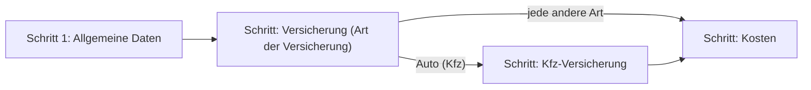

🇩🇪 Deutsch · [🇬🇧 English](EN-Contract-Insurance)

# Vertrag: Versicherung

Die Sparte **Versicherung** ist ein **Pauschalvertrag** für Beiträge, die oft nur einmal im Jahr abgebucht werden. Dazu kommen freiwillige Angaben zur Art der Versicherung und, bei einer Kfz-Versicherung, zum Auto. Diese Angaben dienen nur der Dokumentation, es wird nichts daraus berechnet.

**Inhalt:**
- [Der Ablauf im Formular](#der-ablauf-im-formular)
- [Schritt für Schritt](#schritt-für-schritt)
- [Felder im Überblick](#felder-im-überblick)
- [Was Tariffy anzeigt](#was-tariffy-anzeigt)
- [Beitrag erhöht sich: verlängern](#beitrag-erhöht-sich-verlängern)
- [Rechenbeispiel](#rechenbeispiel)
- [Typische Fehler](#typische-fehler)
- [Siehe auch](#siehe-auch)

## Der Ablauf im Formular

Eine Versicherung hat vor den Kosten einen eigenen Schritt:



Nur bei der Art **Auto (Kfz)** folgt der Schritt mit den Angaben zum Auto. Alle anderen Arten gehen gleich weiter zu den Kosten. Der Kosten-Schritt ist derselbe wie bei [Internet und Mobilfunk](Vertrag-Internet-und-Mobilfunk).

## Schritt für Schritt

1. Im Panel im Tab **Verträge** auf **Neuer Vertrag** klicken. Die allgemeinen Schritte stehen auf [Verträge anlegen](Vertraege-Anlegen).
2. **Schritt 1:** Bezeichnung, Sparte **Versicherung**, Anbieter, Vertragsbeginn, Vertragsende, Kündigungsfrist und Erinnerung eintragen.
3. **Versicherung:** Die **Art der Versicherung** wählen (oder leer lassen).
4. **Nur bei Auto (Kfz):** **Kennzeichen**, **Kilometerstand bei Vertragsbeginn (km)** und **Erlaubte Kilometer pro Jahr (km)** eintragen, alles freiwillig.
5. **Kosten:** **Zahlweise** wählen (bei Versicherungen oft **Jährlich**) und den **Betrag pro Zahlung (€)** eintragen, zum Beispiel den Jahresbeitrag. Bei nicht monatlicher Zahlung setzt du **Erste Abbuchung am**.

Nachträglich änderst du alles mit **Vertrag bearbeiten**; die Schritte sind dieselben.

## Felder im Überblick

Schritt 1 und der Kosten-Schritt sind auf [Vertrag: Internet und Mobilfunk](Vertrag-Internet-und-Mobilfunk#felder-im-überblick) beschrieben. Zusätzlich gibt es bei einer Versicherung:

**Schritt „Versicherung“:**

| Feld | Pflicht | Bedeutung | Standard |
|------|---------|-----------|----------|
| Art der Versicherung | nein | Was die Versicherung abdeckt: Auto (Kfz), Gebäude / Haus, Hausrat, Haftpflicht, Kranken, Leben, Rechtsschutz, Unfall, Sonstige | leer |

**Schritt „Kfz-Versicherung“** (nur bei Auto (Kfz)):

| Feld | Pflicht | Bedeutung | Standard |
|------|---------|-----------|----------|
| Kennzeichen | nein | Das Kennzeichen; gilt als persönlich (siehe unten) | leer |
| Kilometerstand bei Vertragsbeginn (km) | nein | Kilometerstand zu Beginn des Vertrags | leer |
| Erlaubte Kilometer pro Jahr (km) | nein | Im Vertrag vereinbarte Kilometer pro Jahr | leer |

## Was Tariffy anzeigt

- **Im Panel** stehen in den Vertragsdetails die **Art der Versicherung**, der **Kilometerstand bei Beginn** und **Erlaubt pro Jahr**. Das **Kennzeichen** zeigt das Seitenleisten-Panel **nicht**: Es gilt wie die Kundennummer als persönlich. Im Diagnose-Download ist es geschwärzt.
- **Als Sensoren** legt Tariffy für eine Versicherung vier Sensoren an: **Art der Versicherung**, **Kennzeichen**, **Kilometerstand bei Vertragsbeginn** und **Erlaubte Kilometer pro Jahr**. Andere Sparten (außer Leasing, das die drei Fahrzeug-Sensoren bekommt) haben diese Sensoren nicht. Beachte: Der Sensor „Kennzeichen“ zeigt den Wert in Home Assistant an.
- **Die Kosten** laufen wie bei jedem Pauschalvertrag: **Kosten bisher** sind die gebuchten Raten. Wird nicht monatlich gezahlt, zählt jede **Abbuchung** am Tag der Zahlung, kein monatlicher Anteil. Die Vertragsdetails zeigen die erste und die **nächste Zahlung**.

> **Gut zu wissen:** Wechselst du beim Bearbeiten die Art von „Auto (Kfz)“ auf etwas anderes, entfallen Kennzeichen, Kilometerstand und Kilometer pro Jahr, und der Kfz-Schritt wird übersprungen.

## Beitrag erhöht sich: verlängern

Versicherungsbeiträge steigen oft zum Jahreswechsel. Im Tab **Verträge** gibt es dafür das Symbol **Vertrag verlängern** (nur Administratoren). Der Dialog schlägt Beginn am Tag nach dem bisherigen Ende, ein neues Ende ein Jahr später sowie Zahlweise und Betrag wie bisher vor. Du trägst den neuen Beitrag ein und siehst sofort, um wie viel Prozent der Vertrag teurer oder günstiger wird (verglichen pro Monat). Mit **Verlängern** kommt die bisherige Laufzeit in die **Historie**; so entsteht pro Jahr ein Eintrag, und du siehst, wie der Beitrag steigt. Mehr dazu auf [Folgevertrag oder Verlängern](Folgevertrag-oder-Verlaengern).

## Rechenbeispiel

Beispielwerte (nicht aus einem echten Vertrag): Kfz-Versicherung „Kfz Allianz“ bei „Versicherer AG“, Art **Auto (Kfz)**, Beginn 1. Januar 2026, Ende 31. Dezember 2026, Kennzeichen „B-XY 1234“, Kilometerstand bei Vertragsbeginn 12 000 km, erlaubte Kilometer 10 000 pro Jahr.

Der Versicherer bucht den Jahresbeitrag von **896,63 €** ab. Im Kosten-Schritt wählst du Zahlweise **Jährlich** und trägst 896,63 ein.

```
Gespeichert wird der Monatsbetrag:  896,63 € / 12 = 74,72 € im Monat  (gerundet)
Kosten bisher im Jahr 2026:         896,63 €   (die eine Abbuchung)
```

Kurz nach dem Beginn zeigt Tariffy also 896,63 € bei den Kosten bisher, nicht 74,72 €. Verlängerst du den Vertrag zum 1. Januar 2027 und trägst 940 € ein, zeigt der Dialog „4,8 % teurer“ (940 / 12 = 78,33 € statt 74,72 € pro Monat). Die **Kosten gesamt** zählen dann die frühere Laufzeit aus der Historie plus die Abbuchungen der neuen Laufzeit.

## Typische Fehler

- **Jahresbeitrag mit Zahlweise „Monatlich“.** Dann zählt Tariffy zwölfmal den Jahresbeitrag. Wähle **Jährlich** (oder rechne den Monatsbetrag aus).
- **Erste Abbuchung nicht gesetzt.** Bucht der Versicherer nicht am Vertragsbeginn ab, setze **Erste Abbuchung am**, sonst nimmt Tariffy den Vertragsbeginn an.
- **Kennzeichen im Panel gesucht.** Das Panel zeigt es mit Absicht nicht; es steht im Sensor „Kennzeichen“.
- **Kfz-Angaben fehlen.** Der Kfz-Schritt erscheint nur bei der Art **Auto (Kfz)**; ist die Art leer, wird er übersprungen.
- **Erwartung, dass Kilometer gerechnet werden.** Bei der Versicherung werden die Kilometer nur dokumentiert. Eine Rechnung gegen den Kilometerstand gibt es nur beim [Leasing](Vertrag-Leasing).

> **Gut zu wissen:** Beim Bearbeiten sind alle Felder mit den bisherigen Werten gefüllt. Ein leeres optionales Feld entfernt den Wert.

## Siehe auch

- [Vertrag: Internet und Mobilfunk](Vertrag-Internet-und-Mobilfunk)
- [Vertrag: Leasing](Vertrag-Leasing)
- [Folgevertrag oder Verlängern](Folgevertrag-oder-Verlaengern)
- [Abschläge und Kosten](Abschlaege-und-Kosten)
- [Sensoren-Referenz](Sensoren-Referenz)
