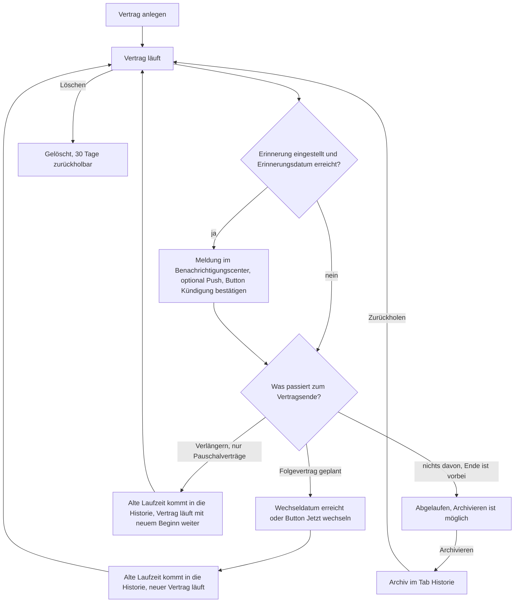

🇩🇪 Deutsch · [🇬🇧 English](EN-Contract-End-and-Switching)

# Vertragsende und Wechsel

Diese Seite zeigt, was Tariffy rund um das Ende eines Vertrags für Dich erledigt: an die Kündigung erinnern, den Folgevertrag vormerken und zum Stichtag automatisch umschalten oder einen Pauschalvertrag verlängern. Sie ist für alle gedacht, die ihre Verträge nicht aus den Augen verlieren wollen.

**Inhalt:**

- [Der Lebenslauf eines Vertrags](#der-lebenslauf-eines-vertrags)
- [Kündigungs-Erinnerung](#kündigungs-erinnerung)
- [Kündigungsfrist und Mindestlaufzeit](#kündigungsfrist-und-mindestlaufzeit)
- [Folgevertrag planen](#folgevertrag-planen)
- [Kurzform für Streaming](#kurzform-für-streaming)
- [Automatischer Wechsel am Wechseldatum](#automatischer-wechsel-am-wechseldatum)
- [Vertrag verlängern](#vertrag-verlängern)
- [Die Buttons pro Vertrag](#die-buttons-pro-vertrag)
- [Beispiel mit Zahlen](#beispiel-mit-zahlen)

## Der Lebenslauf eines Vertrags

Das Diagramm zeigt, welche Wege ein Vertrag in Tariffy nehmen kann. Es beschreibt nur, was die Integration wirklich tut: Nichts wird automatisch archiviert, und Tariffy kündigt nie selbst, es erinnert Dich nur.

## Kündigungs-Erinnerung

Die Erinnerung gibt es, wenn beim Vertrag ein **Vertragsende** eingetragen ist und bei **Kündigung erinnern** nicht „Keine Erinnerung" steht. Zur Wahl stehen „1 Monat vorher" bis „4 Monate vorher". Du stellst sie beim Anlegen oder später unter **Vertrag bearbeiten** ein (siehe [Vertraege-Anlegen](Vertraege-Anlegen)).

Sobald das Erinnerungsdatum erreicht ist, passiert Folgendes:

1. Im Benachrichtigungscenter von Home Assistant erscheint eine **Dauerbenachrichtigung** mit dem Titel „Kündigung: <Vertragsname>". Sie nennt Anbieter, Tarif und Vertragsende.
2. Ist ein **Benachrichtigungs-Ziel (notify-Dienst)** eingetragen, kommt **einmalig** eine Push-Nachricht mit demselben Text. Das Ziel ist freiwillig, ein Beispiel ist `notify.mobile_app`.
3. Der Button **Kündigung bestätigen** wird verfügbar. Mit ihm quittierst Du die Erinnerung: Die Dauerbenachrichtigung verschwindet und kommt für diese Laufzeit nicht wieder.

Die Erinnerung gilt vom Erinnerungsdatum bis zum Vertragsende einschließlich. Danach ist sie aus. Das Erinnerungsdatum zeigt der Sensor „Kündigungs-Erinnerung" als Wert, im Panel steht es als „Erinnerung ab" in den Vertragsdetails.

Quittieren kannst Du an drei Stellen, sie bewirken dasselbe:

- mit dem Button **Kündigung bestätigen** am Gerät des Vertrags in Home Assistant,
- im Panel im Tab **Verträge** in den Details des Vertrags (dort heißt die Schaltfläche **Kündigung bestätigen**, eine Rückfrage folgt, siehe [Panel-Vertraege](Panel-Vertraege)),
- im Dialog **Folgevertrag** mit dem Häkchen **Kündigung als erledigt markieren** (siehe unten).

> **Gut zu wissen:** Das Eintragen eines Folgevertrags beendet die Erinnerung nicht von selbst. Du bestätigst sie selbst, oder Du lässt das Häkchen im Folgevertrag-Dialog an.

> **Gut zu wissen:** Ändern sich Vertragsende, Erinnerungszeitraum oder Kündigungsfrist beim Bearbeiten, beginnt die Erinnerung von vorn: Bestätigung und „Push schon gesendet" werden vergessen. Ändert sich nichts davon, bleiben beide erhalten. Ein archivierter Vertrag erinnert nicht mehr, und beim Archivieren wird die Dauerbenachrichtigung entfernt.

## Kündigungsfrist und Mindestlaufzeit

Beide Felder sind freiwillig und stehen im Vertragsformular (Anlegen und **Vertrag bearbeiten**).

- **Kündigungsfrist (Monate):** Wie viele Monate vor dem Vertragsende die Kündigung vorliegen muss. Ist sie eingetragen, bezieht sich die Erinnerung auf den **letzten Kündigungstag** (Vertragsende minus Frist) statt auf das Vertragsende. Die Meldung nennt diesen Tag. Der Sensor „Kündigungs-Erinnerung" hat dazu die Attribute `kuendigungsfrist_monate` und `kuendigung_bis`.
- **Mindestlaufzeit (Monate):** Das Panel zeigt „bis <Beginn + Mindestlaufzeit>". Sie beeinflusst keine Erinnerung.

Rechenregel für das Erinnerungsdatum: Vertragsende minus (Erinnerungsmonate plus Kündigungsfrist). Steht die Erinnerung auf „Keine Erinnerung", gibt es auch mit Kündigungsfrist keine Erinnerung; der letzte Kündigungstag wird aber weiter angezeigt.

> **Gut zu wissen:** Bei einem Tarifwechsel bleibt die Kündigungsfrist erhalten, die Mindestlaufzeit nicht.

## Folgevertrag planen

Weißt Du schon, wie es weitergeht, trägst Du den Folgevertrag ein. Tariffy übernimmt ihn dann am Wechseldatum von selbst.

**Im Panel (Administratoren):**

1. Öffne den Tab **Verträge**.
2. Klicke in der Zeile des Vertrags auf das Symbol **Folgevertrag planen** (steht schon ein Folgevertrag drin, heißt es **Folgevertrag bearbeiten**).
3. Fülle den Dialog „Folgevertrag · <Vertragsname>" aus. Felder, die Du leer lässt, behalten den Wert des laufenden Vertrags.
4. Klicke auf **Speichern**. Home Assistant lädt den Vertrag danach neu.

Alternativ geht es in Home Assistant unter **Einstellungen → Geräte & Dienste → Tariffy → [Vertrag] → Optionen**; es ist dasselbe Formular, das das Panel öffnet. Für einen Kredit zeigt das Panel kein Symbol für einen Folgevertrag, er hat stattdessen eine Anschlussfinanzierung (siehe [Vertrag-Kredit](Vertrag-Kredit)).

*Abbildung: Der Dialog „Folgevertrag · Internet" mit Mock-Daten. Das Datumsformat richtet sich nach Deinem Browser.*

Die Felder im Formular (bei Strom, Gas und Wasser kommen je nach Vertrag Arbeitspreis, Verbrauchswerte und weitere hinzu):

| Feld | Bedeutung |
|------|-----------|
| Wechseldatum (Beginn neuer Vertrag) | Der Tag, an dem der neue Vertrag übernimmt. **Leer lassen entfernt einen geplanten Wechsel.** |
| Anbieter (neu), Kundennummer (neu), Tarifname (neu) | Neue Stammdaten |
| Abschlag neu (€/Monat), Grundpreis neu (€/Monat) | Neue Beträge |
| Vertragsende neu / Laufzeit bis | Ende der neuen Laufzeit |
| Kündigung als erledigt markieren | Nur im Panel und nur, wenn die Erinnerung gerade aktiv ist. Standardmäßig angehakt: Nach dem Speichern wird die Erinnerung bestätigt. |

Über **Geplanten Vertrag entfernen** (mit Rückfrage) nimmst Du die Planung zurück; der laufende Vertrag bleibt unverändert. Ein geplanter Vertrag erscheint als Hinweis „Folgevertrag ab <Datum>: <Name>" und am Sensor „Nächster Wechsel" (Wert: das Wechseldatum, Attribute: die neuen Werte).

## Kurzform für Streaming

Die Sparte **Streaming** hat ein kürzeres Formular, ebenfalls „Folgevertrag planen" genannt:

| Feld | Bedeutung |
|------|-----------|
| Beginn der neuen Laufzeit | Ohne Eingabe wird der **Tag nach dem Vertragsende** vorgeschlagen. Leer lassen entfernt einen geplanten Vertrag. |
| Tarifname (neu) | Name des neuen Tarifs |
| Zahlweise (neu) | Monatlich, Vierteljährlich, Halbjährlich oder Jährlich, zum Beispiel von jährlich auf monatlich |
| Betrag pro Zahlung (neu, €) | Der Betrag je Abbuchung; Tariffy rechnet ihn intern auf den Monatsbetrag um |
| Ende der neuen Laufzeit / gültig bis | Ende der neuen Laufzeit |

Anbieter, Kundennummer und Grundpreis zeigt das Formular nur, wenn ein bereits geplanter Vertrag sie schon hat. Was Du nicht änderst, bleibt wie im laufenden Vertrag, auch die Zahlweise. Die erste Abbuchung der neuen Laufzeit ist ihr Beginn. Alle anderen Sparten behalten ihr normales Formular. Mehr zu Streaming: [Vertrag-Streaming](Vertrag-Streaming).

## Automatischer Wechsel am Wechseldatum

Tariffy prüft den Wechsel täglich um 00:00:01 Uhr, außerdem bei jeder regulären Aktualisierung (alle 6 Stunden) und nach dem Start von Home Assistant. Ist das Wechseldatum erreicht oder überschritten, geschieht Folgendes:

1. Bei Strom, Gas und Wasser wird der **Verbrauch der endenden Laufzeit eingefroren** (Sensor „Verbrauch (Letzte Laufzeit)") samt ihrer tatsächlichen Dauer in Monaten. Daraus rechnet der Sensor „Abschlag (Empfohlen)" für den neuen Vertrag. Details und ein Rechenbeispiel stehen unter [Folgevertrag-oder-Verlaengern](Folgevertrag-oder-Verlaengern).
2. Die **alte Laufzeit kommt in die Historie** (Zeitraum, Anbieter, Tarif, Preise, Abschlag, Kosten, Verbrauch, Saldo; keine Kunden- und Zählernummern), siehe [Archiv-und-Historie](Archiv-und-Historie). Pro Vertrag bleiben höchstens 50 Laufzeiten, die ältesten fallen heraus.
3. Die **Vertragsdaten werden durch den Folgevertrag ersetzt**. Felder, die Du im Folgevertrag leer gelassen hast, behalten ihren bisherigen Wert.
4. Die Integration lädt den Vertrag neu, weil je nach neuem Vertrag andere Sensoren nötig sind (zum Beispiel für Staffelpreise).

Mitgenommen werden außerdem Erinnerungszeitraum, Kündigungsfrist, Benachrichtigungs-Ziel, Einmalposten, eigenes Icon, die PV-Autarkie-Einstellungen, die Außenzähler eines Wasservertrags (ohne Startwert) und bei Leasing Fahrzeug und Kilometerregeln. Nicht mitgenommen werden der Abschlagsverlauf, die Mindestlaufzeit, ein manueller Zählerstand bei Vertragsbeginn, Kilometerstand bei Beginn und von Hand eingetragener Kilometerstand. Bestätigungen und „Push gesendet"-Merker der alten Laufzeit fallen ebenfalls weg, die Erinnerung beginnt also zum neuen Vertragsende von vorn.

> **Gut zu wissen:** Die Option „Warnen, wenn Abschlag zu niedrig ist" mit ihrer Warnschwelle gehört nicht zu den mitgenommenen Werten. Prüfe sie nach einem Wechsel unter **Vertrag bearbeiten**.

> **Gut zu wissen:** Der Wechsel läuft auch, wenn Home Assistant am Wechseltag aus war: Beim nächsten Start wird er nachgeholt. Der Verbrauch der alten Laufzeit wird dann aus den Langzeitstatistiken des Zählers bestimmt. Fehlen sie oder ist ein manueller Zählerstand bei Vertragsbeginn eingetragen, wird nichts eingefroren.

## Vertrag verlängern

**Verlängern** gibt es für Verträge ohne Verbrauchszähler (Internet, Mobilfunk, Streaming, Versicherung, Leasing, Kredit, Sonstiges), solange sie nicht archiviert sind. Strom, Gas und Wasser lassen sich nicht verlängern, dafür nimmst Du den Folgevertrag. Ein **Vertragsende ist nicht nötig**: Auch ein unbefristeter Vertrag lässt sich verlängern, etwa bei einer Preisanpassung.

1. Öffne im Panel den Tab **Verträge** und klicke in der Zeile auf das Symbol **Vertrag verlängern** (zwei Pfeile im Kreis).
2. Der Dialog schlägt Beginn am Tag nach dem bisherigen Ende vor und ein neues Ende ein Jahr später. Hat der Vertrag kein Ende, ist der Beginn heute und das Ende leer. Zahlweise und Betrag sind wie bisher vorbelegt.
3. Trage den neuen **Betrag pro Zahlung** ein. Der Dialog zeigt sofort, um wie viel Prozent der Vertrag teurer oder günstiger wird, verglichen pro Monat.
4. Klicke auf **Verlängern**.

*Abbildung: Der Dialog „Vertrag verlängern" mit Mock-Daten: 432 € pro Jahr statt 39,99 € pro Monat ergibt 36,00 € pro Monat, also „10,0 % günstiger".*

Das passiert beim Verlängern:

- Die bisherige Laufzeit kommt in die **Historie**.
- Der Vertrag läuft mit neuem Beginn, Ende und Betrag weiter. Anbieter, Tarif, Kundennummer und alles andere bleiben.
- Bestätigte Erinnerungen, der Abschlagsverlauf und eine archivierte Markierung gehören zur alten Laufzeit und beginnen von vorn. Die Erinnerung richtet sich nach dem neuen Ende.
- Eine eventuell offene Erinnerung und die Abschlag-Warnung werden als Benachrichtigung entfernt.
- Die **Erste Abbuchung (optional)** brauchst Du nur, wenn die erste Abbuchung der neuen Laufzeit nicht am Beginn liegt.

Ein **Kredit** hat statt dessen eine **Anschlussfinanzierung** mit neuer Summe, Zins und Laufzeit; die Summe ist meist die Restschuld (siehe [Vertrag-Kredit](Vertrag-Kredit)).

## Die Buttons pro Vertrag

Jeder Vertrag hat in Home Assistant drei Buttons am Gerät. Sie sind nur dann verfügbar, wenn sie etwas tun können.

| Button | Verfügbar, wenn | Wirkung |
|--------|-----------------|---------|
| Jetzt wechseln | ein Folgevertrag geplant ist | Übernimmt den Folgevertrag sofort, ohne auf das Datum zu warten. Friert den Verbrauch der endenden Laufzeit genauso ein wie der automatische Wechsel. |
| Kündigung bestätigen | die Erinnerung gerade aktiv ist | Quittiert die Erinnerung und entfernt die Dauerbenachrichtigung. |
| Abschlag-Warnung bestätigen | die Nachzahlungs-Warnung gerade zu bestätigen ist | Quittiert die Warnung und entfernt die Dauerbenachrichtigung. Verbessert sich die Prognose später über die Schwelle und verschlechtert sich dann wieder, meldet sich die Warnung automatisch neu. |

> **Gut zu wissen:** **Jetzt wechseln** gibt es nur als Button in Home Assistant, nicht im Panel. Als Beginn der neuen Laufzeit gilt das eingetragene Wechseldatum, auch wenn es noch in der Zukunft liegt.

## Beispiel mit Zahlen

Beispiel: Ein Stromvertrag endet am 31.12., die Kündigungsfrist beträgt 3 Monate, bei **Kündigung erinnern** steht „3 Monate vorher".

- Die Kündigung muss bis **30.09.** vorliegen (31.12. minus 3 Monate).
- Die Erinnerung kommt am **30.06.** (31.12. minus 3 plus 3 Monate), also 6 Monate vor dem Vertragsende.
- Die Meldung nennt den 30.09. als letzten Kündigungstag. Du kündigst beim Anbieter und drückst **Kündigung bestätigen**.
- Ohne Kündigungsfrist käme die Erinnerung am 30.09., drei Monate vor dem Ende.

Das entspricht den Tests der Integration (Vertragsende 31.12.2026, Kündigungsfrist 3, Erinnerung 3: letzter Kündigungstag 30.09.2026, Erinnerungsdatum 30.06.2026).

## Siehe auch

- [Folgevertrag-oder-Verlaengern](Folgevertrag-oder-Verlaengern): Was ändert sich in den Sensoren, und wann nimmst Du was?
- [Archiv-und-Historie](Archiv-und-Historie): Abgelaufene Verträge archivieren, frühere Laufzeiten ansehen und nachtragen
- [Automationen](Automationen): Eigene Erinnerungen und Warnungen
- [Vertraege-Anlegen](Vertraege-Anlegen): Erinnerung, Kündigungsfrist und Benachrichtigungs-Ziel einstellen
- [Panel-Vertraege](Panel-Vertraege): Alle Aktionen im Tab Verträge
- [Abschlaege-und-Kosten](Abschlaege-und-Kosten): Abschlag-Warnung und empfohlener Abschlag
